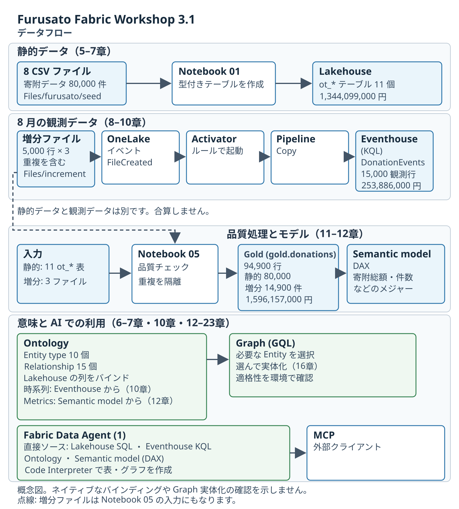

# 1.2 操作手順（1）

[Lab 目次](../README.md) · [この章の目次](README.md)

1. 次の4つの問いを読み、それぞれの答えに何が必要かを考えます。①寄付を最も多く受け入れた自治体はどこか（件数か、金額か）。②「東京の寄付」は受け入れか、在住者の寄付か。③ある寄付の返礼品を提供できる事業者はどこか（それは「発送した」と同じ意味か）。④8月に届いた観測データは、静的データの続きか、別のデータか。
2. データの経路を3本、別々に図にします。静的データ：8つの CSV → Notebook 01 → Lakehouse の ot_* テーブル。8月の観測データ：Files/increment へのファイル作成 → OneLake イベント → Activator → Pipeline → Eventhouse。品質処理：Notebook 05 → Gold → Semantic model。

データ経路を分けて示す概念図。各環境でのネイティブなバインディングや Graph 実体化の確認を示すものではありません。

English

## 1.2 Steps

1. Read the following four questions and think about what each answer needs. (1) Which municipality received the most donations — by count or by amount? (2) Do "Tokyo donations" mean donations received or donations by residents? (3) Which suppliers can provide the gift of a given donation — and does that mean they shipped it? (4) Are the observations that arrived in August a continuation of the static data or a separate dataset?
2. Sketch the three data paths separately. Static data: eight CSV files → Notebook 01 → ot_* tables in the Lakehouse. August observation data: file created in Files/increment → OneLake event → Activator → Pipeline → Eventhouse. Quality processing: Notebook 05 → Gold → semantic model.

Conceptual diagram with separate data paths. It does not establish native bindings or Graph materialization in any environment.

