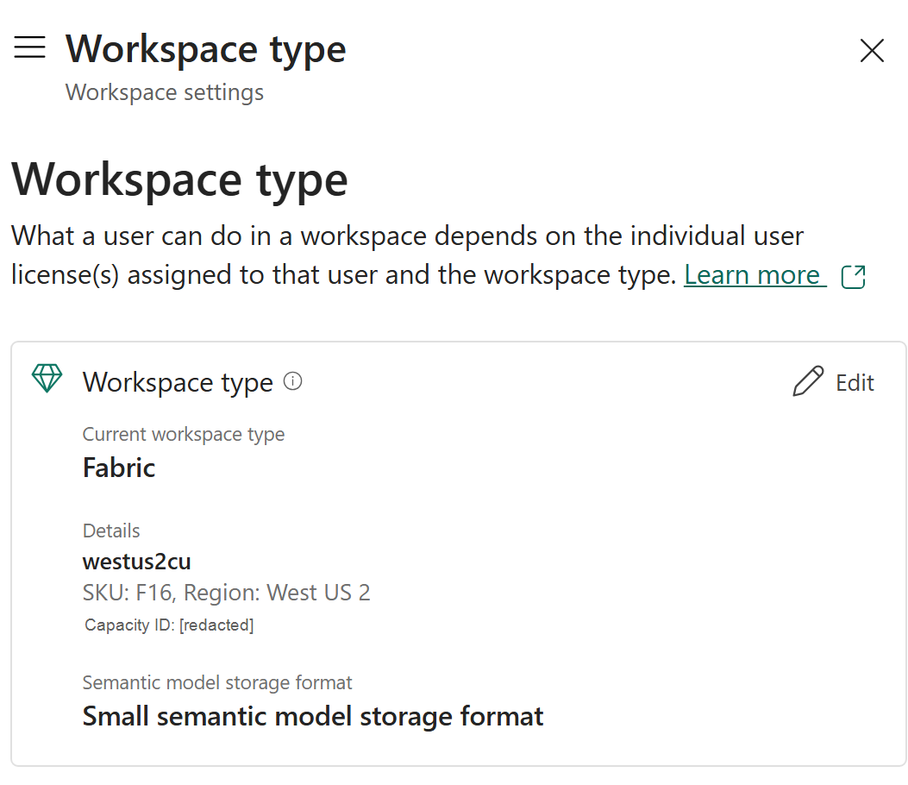

# 4.2 操作手順（1）

[Lab 目次](../README.md) · [この章の目次](README.md)

1. 割り当てられた、または自分に操作が許可されたワークスペースと作業フォルダーを開きます。手動でアイテムを作成・インポートするときは、先にこのフォルダーを開き、作成後も置き場所を確認します。コマンドの配置先は24.4の実際のフォルダー対応で固定します。
2. 参加者IDを確認します。&lt;PID&gt; は 001〜999 の3桁の文字列です（000、空欄、4桁以上では Notebook 01 が停止します）。アイテム名の末尾には &lt;PID&gt; を付けます。例：LH_Furusato_&lt;PID&gt;、EH_Furusato_&lt;PID&gt;、PL_Furusato_&lt;PID&gt;、ONT_Furusato_&lt;PID&gt;、SM_Furusato_Analytics_&lt;PID&gt;、DA_Furusato_&lt;PID&gt;、My activator_&lt;PID&gt;。
3. 使える機能と権限を、見るだけで確認します。Settings → Workspace type で割り当てられた容量（capacity）を確認し、Edit は押さず設定を変更しません。下図は現在のUIでの事前確認の例で、F16 は最低要件ではありません。Ontology、Ontology agent、Data Agent が作成メニューやツールバーに表示されること、各アイテムに必要な読み取り・ビルド・書き込みの権限があることを確かめます。

2026-11-01 に対象ワークスペースで取得・確認した Settings → Workspace type の実画面。Fabric、F16、West US 2 を示す現在のUIでの事前確認の例です。F16 はこの例の容量であり、最低要件ではありません。Capacity ID は伏せています。配置後の成功証拠ではありません。参加者は表示を確認するだけで、Edit を押さず設定を変更しません。

English

## 4.2 Steps

1. Open the assigned workspace and folder, or the scope you are authorized to use. Before manually creating or importing an item, open this folder and verify the item’s location afterwards. The command deployment target is fixed by the actual folder mapping in 24.4.
2. Confirm your participant ID. &lt;PID&gt; is a three-digit string from 001 to 999 (Notebook 01 stops on 000, an empty value or four or more digits). Item names end with &lt;PID&gt;, for example LH_Furusato_&lt;PID&gt;, EH_Furusato_&lt;PID&gt;, PL_Furusato_&lt;PID&gt;, ONT_Furusato_&lt;PID&gt;, SM_Furusato_Analytics_&lt;PID&gt;, DA_Furusato_&lt;PID&gt; and My activator_&lt;PID&gt;.
3. Check available features and permissions by looking only. In Settings → Workspace type, inspect the assigned capacity; do not click Edit or change settings. The figure is a current-UI preflight example, not an F16 minimum requirement. Confirm that Ontology, Ontology agent and Data Agent appear in the create menus or toolbars, and that you have the read, build and write permissions each item needs.

Actual Settings → Workspace type screen captured and reviewed in the requested workspace on 2026-11-01. This current-UI preflight example shows Fabric, F16 and West US 2. F16 is the example capacity, not a minimum requirement. Capacity ID is redacted. This is not post-deployment evidence. Participants only inspect the display; do not click Edit or change settings.

