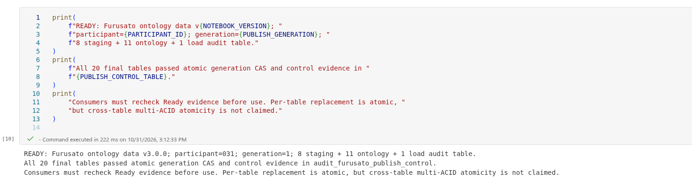

# 5.2 操作手順（1）

[Lab 目次](../README.md) · [この章の目次](README.md)

1. Lakehouse を開き、Files の下にフォルダーを作って、パスが Files/furusato/seed になるようにします（furusato フォルダーの中に、もう1つフォルダーを作ります）。ここに8つの CSV をアップロードします。8月の観測データ（donation_events_001〜003.csv）はここに置きません。
2. 続けて、Files の下に空の increment フォルダー（Files/increment）を作ります。9章でこのフォルダーへのファイルの到着を監視するため、今は何も置きません。
3. アップロードしたファイルのサイズを data フォルダーの dataset-manifest.json と比べ、8ファイルがそろっていることを確認します。
4. Notebook 01 を作業フォルダーにインポートし、LH_Furusato_&lt;PID&gt; を接続（attach）します。
5. 先頭のパラメーターセルで PARTICIPANT_ID を自分の &lt;PID&gt; に変更します。ほかの値は変更しません（INPUT_DIR は "Files/furusato/seed" のままにします）。
6. すべてのセルを先頭から順に実行します（Run all）。最後に「READY: Furusato ontology data v」に NOTEBOOK_VERSION の値が続く行と、20テーブルの確認が出力されれば完了です。

Notebook 01 の最終セル。READY v3.0.0 と、8 staging・11 Ontology・1 load audit の計20テーブルの検査完了が表示されます。利用前に Ready の根拠を再確認し、SQL endpoint での同期も次の手順で確認します。

English

## 5.2 Steps

1. Open the Lakehouse and create folders under Files so that the path is Files/furusato/seed (a furusato folder with one more folder inside it). Upload the eight CSV files there. Do not put the August observation data (donation_events_001 to 003.csv) here.
2. Next, create an empty increment folder under Files (Files/increment). Chapter 9 watches this folder for file arrivals, so leave it empty for now.
3. Compare the uploaded file sizes with dataset-manifest.json in the data folder and confirm that all eight files are present.
4. Import Notebook 01 into your work folder and attach LH_Furusato_&lt;PID&gt;.
5. In the first parameter cell, change PARTICIPANT_ID to your &lt;PID&gt;. Leave all other values unchanged (INPUT_DIR stays "Files/furusato/seed").
6. Run all cells from the top (Run all). It is complete when the output ends with "READY: Furusato ontology data v" followed by the NOTEBOOK_VERSION value and a confirmation for all 20 tables.

Notebook 01 final cell. The output reports READY v3.0.0 and completed checks for 20 tables: 8 staging, 11 ontology, and 1 load audit. Recheck Ready evidence before use, then verify SQL endpoint synchronization in the next steps.

