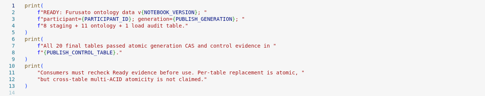
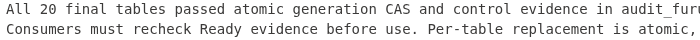
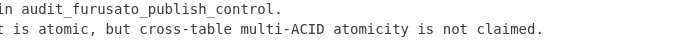

# 5.2 操作手順（1）

[Lab 目次](../README.md) · [この章の目次](README.md)

1. Lakehouse を開き、Files の下にフォルダーを作って、パスが Files/furusato/seed になるようにします（furusato フォルダーの中に、もう1つフォルダーを作ります）。ここに8つの CSV をアップロードします。8月の観測データ（donation_events_001〜003.csv）はここに置きません。
2. 続けて、Files の下に空の increment フォルダー（Files/increment）を作ります。9章でこのフォルダーへのファイルの到着を監視するため、今は何も置きません。
3. アップロードしたファイルのサイズを data フォルダーの dataset-manifest.json と比べ、8ファイルがそろっていることを確認します。
4. Notebook 01 を作業フォルダーにインポートし、LH_Furusato_&lt;PID&gt; を接続（attach）します。
5. 先頭のパラメーターセルで PARTICIPANT_ID を自分の &lt;PID&gt; に変更します。ほかの値は変更しません（INPUT_DIR は "Files/furusato/seed" のままにします）。
6. すべてのセルを先頭から順に実行します（Run all）。最後に「READY: Furusato ontology data v」に NOTEBOOK_VERSION の値が続く行と、20テーブルの確認が出力されれば完了です。

Notebook 01 の最終セルのコード部分を示す実画面の抜粋です。READY、8 staging・11 Ontology・1 load audit の計20テーブル、利用前の再確認に関する表示処理を確認できます。実行結果や現在の成功を示す図ではありません。自分の実行出力で Ready の根拠を確認し、次の手順で SQL endpoint の同期を確認します。

20テーブルの制御証拠と利用前の再確認警告を示す実出力の抜粋例の左側。次の図と100ピクセル重なります。この抜粋は現在の成功を証明しません。自分の実行で確認してください。

同じ2行の右側の続き。テーブル単位の置換はatomicですが、テーブル間のmulti-ACID atomicityは主張しない、という警告を保持します。前の左側と合わせて読みます。この抜粋だけで自分の実行結果を確認済みとは扱いません。

English

## 5.2 Steps

1. Open the Lakehouse and create folders under Files so that the path is Files/furusato/seed (a furusato folder with one more folder inside it). Upload the eight CSV files there. Do not put the August observation data (donation_events_001 to 003.csv) here.
2. Next, create an empty increment folder under Files (Files/increment). Chapter 9 watches this folder for file arrivals, so leave it empty for now.
3. Compare the uploaded file sizes with dataset-manifest.json in the data folder and confirm that all eight files are present.
4. Import Notebook 01 into your work folder and attach LH_Furusato_&lt;PID&gt;.
5. In the first parameter cell, change PARTICIPANT_ID to your &lt;PID&gt;. Leave all other values unchanged (INPUT_DIR stays "Files/furusato/seed").
6. Run all cells from the top (Run all). It is complete when the output ends with "READY: Furusato ontology data v" followed by the NOTEBOOK_VERSION value and a confirmation for all 20 tables.

Actual UI excerpt showing the code in the final Notebook 01 cell: the READY message, 20 tables (8 staging, 11 ontology and 1 load audit), and the consumer recheck warning. This is not an execution result or evidence of current success. Check Ready evidence in your own run output, then verify SQL endpoint synchronization in the next steps.

Left excerpt of actual output illustrating the 20-table control evidence and consumer recheck warning, overlapping the next panel by 100 pixels. This example does not establish current success. Verify your own run.

Right continuation of the same two lines, retaining the warning that per-table replacement is atomic but cross-table multi-ACID atomicity is not claimed. Read with the overlapping left panel; this excerpt does not verify your own execution.

