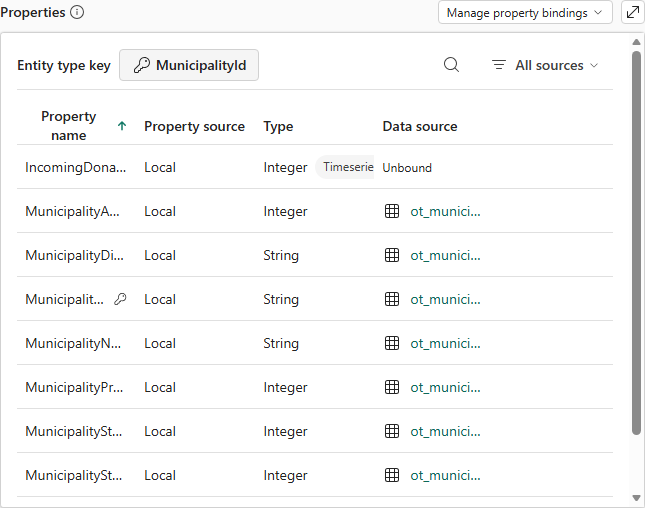

# 6.2 操作手順（1）

[Lab 目次](../README.md) · [この章の目次](README.md)

1. Home の Add entity type を選び、名前（例：Prefecture）を入力して Add Entity Type を選びます。Explorer で作成した Entity type を選び、View Entity Type details を開きます。
2. Configure で Manage property bindings を開き、Add binding and properties を選びます（Property がまだ無い場合は Add properties from data）。Property binding の Add で、LH_Furusato_&lt;PID&gt; の対応するテーブル（Prefecture なら ot_prefecture）を選びます。
3. Entity type properties で、Property 名・元の列・型（String または Integer）を1行ずつ確認し、Create を選びます。Entity type updated successfully と表示されたら Cancel で閉じ、Configure を開き直して保存された内容を確認します。
4. Entity type key を設定します。キーは下の表のとおり、変わらない String または Integer の列にします。MunicipalityId は先頭のゼロを含む6桁の String です。キーの無い Entity type は Graph の対象になりません。
5. 残りの9つの Entity type も同じ手順で作ります。表の元テーブルと Property 数に合わせ、10の Entity type の静的 Property が合計72になることを確認します。
6. Municipality の時系列 Property（IncomingDonationAmountYen）は10章でバインドします。すでに定義されている場合、この時点では Data source が Unbound と表示されますが、正常です。

Municipality の Configure 画面。キーは MunicipalityId で、静的 Property は ot_municipality にバインド済み。時系列 Property は10章でバインドするまで Unbound

English

## 6.2 Steps

1. Select Add entity type on Home, enter a name (for example Prefecture) and select Add Entity Type. Select the new entity type in Explorer and open View Entity Type details.
2. In Configure, open Manage property bindings and select Add binding and properties (Add properties from data if there are no properties yet). Under Property binding, select Add and choose the matching table in LH_Furusato_&lt;PID&gt; (ot_prefecture for Prefecture).
3. In Entity type properties, check the property name, source column and type (String or Integer) row by row, then select Create. When Entity type updated successfully appears, close with Cancel and reopen Configure to check what was saved.
4. Set the Entity type key. As the table shows, the key is a stable String or Integer column. MunicipalityId is a six-character String that includes leading zeros. An entity type without a key cannot be included in a graph.
5. Create the remaining nine entity types in the same way. Follow the source table and property count in the table, and confirm that the 10 entity types have 72 static properties in total.
6. The time-series property of Municipality (IncomingDonationAmountYen) is bound in Chapter 10. If it is already defined, its Data source shows Unbound at this point; that is expected.

Municipality Configure page: the key is MunicipalityId and the static properties are bound to ot_municipality. The time-series property stays Unbound until Chapter 10.

