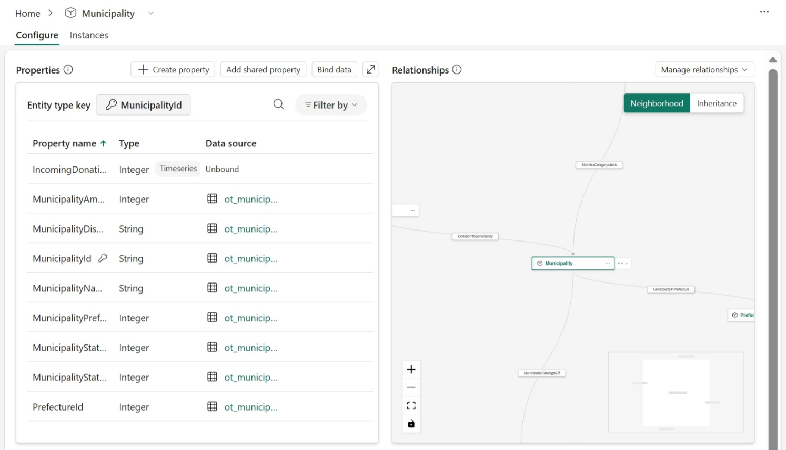

# 6.2 操作手順（1）

[Lab 目次](../README.md) · [この章の目次](README.md)

1. Home の Add entity type を選び、名前（例：Prefecture）を入力して Add Entity Type を選びます。Explorer で作成した Entity type を選び、View Entity Type details を開きます。
2. Configure に Manage property bindings が表示される場合はそれを開きます。表示されず Configure の toolbar に Bind data がある場合は Bind data を選びます。どちらの入口でも、画面に実際に表示されるコントロールだけを使います。新しい binding 画面や初回案内で、対象テーブル・キー・列を確認できない場合は作成・保存せず停止して講師に確認します。
3. 標準経路では、Configure の Bind data から既存の Data sources と Properties を開き、Primary のデータソース、Property 名・source column の全名・型（String または Integer）を本章の表と照合します。Municipality の例では ot_municipality が Primary と表示されます。source column 名が省略され全名を確認できない場合は、一致と判断せず、設定を変更せず講師に確認します。Add shared property は選びません。手動で新規作成する場合に限り、Add binding and properties などの操作が実際に表示される場合に使います。Create と Entity type updated successfully が表示された場合は Cancel で閉じ、Configure を開き直して保存内容を読み戻します。確認可能な項目や保存結果が画面にない場合は、変更せず講師に確認します。

Municipality の Configure 画面。Entity type key は MunicipalityId です。Properties 表に8行の型と省略表示されたデータソースがあり、時系列 Property は Timeseries / Unbound と表示されています。

English

## 6.2 Steps

1. Select Add entity type on Home, enter a name (for example Prefecture) and select Add Entity Type. Select the new entity type in Explorer and open View Entity Type details.
2. If Configure shows Manage property bindings, open it. If that entry is absent and the Configure toolbar shows Bind data, select Bind data instead. Use only controls actually shown on screen. If a new binding screen or first-run tour does not let you verify the source table, key and columns, stop without creating or saving and ask the instructor.
3. In the standard route, open the existing Data sources and Properties from Configure → Bind data, then compare the Primary data source, property names, full source-column names and types (String or Integer) with this chapter's tables. The Municipality example marks ot_municipality as Primary. If a source-column label is truncated and its full name cannot be verified, do not treat it as a match; make no changes and ask the instructor. Do not select Add shared property. Only for a manual new build, use Add binding and properties or similar controls if they are actually shown. If Create and Entity type updated successfully appear, close with Cancel and reopen Configure to read back the saved values. If the screen does not expose verifiable fields or a saved result, make no change and ask the instructor.

Municipality Configure view: MunicipalityId is the entity type key. The Properties table shows types and truncated data-source labels for eight rows; the time-series property is marked Timeseries / Unbound.

