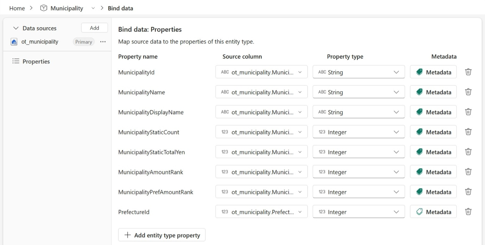

# 6.2 操作手順（2）

[Lab 目次](../README.md) · [この章の目次](README.md)

Municipality の Bind data: Properties 画面。Data sources では ot_municipality が Primary と表示され、8行の Property 名・source column・型が並びます。source column 名は省略表示のため、手順に沿って全名を照合してください。

English

## 6.2 Steps

Municipality Bind data: Properties view. The Data sources pane marks ot_municipality as Primary; eight rows show property names, source columns and types. Source-column labels are truncated, so verify their full names as described in the steps.

