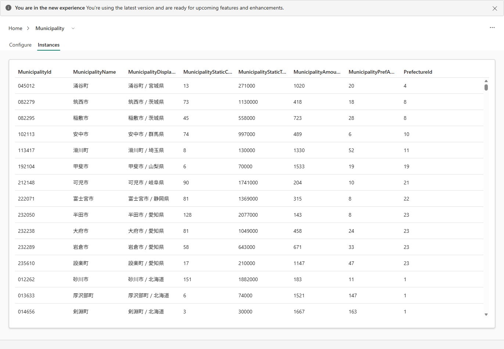

# 6.2 操作手順（2）

[Lab 目次](../README.md) · [この章の目次](README.md)

7. 各 Entity type の Instances タブを開き、実際の行が表示されることを確認します。Municipality では、MunicipalityId が 045012 のように先頭のゼロ付きで表示されます。

Municipality の Instances タブ。実際の行が表示され、012262 のように ID の先頭のゼロも残っている

English

## 6.2 Steps

7. Open the Instances tab of each entity type and confirm that actual rows appear. For Municipality, MunicipalityId shows leading zeros, for example 045012.

Municipality Instances tab: actual rows from ot_municipality are listed, and leading zeros in MunicipalityId (for example 012262) are kept.

