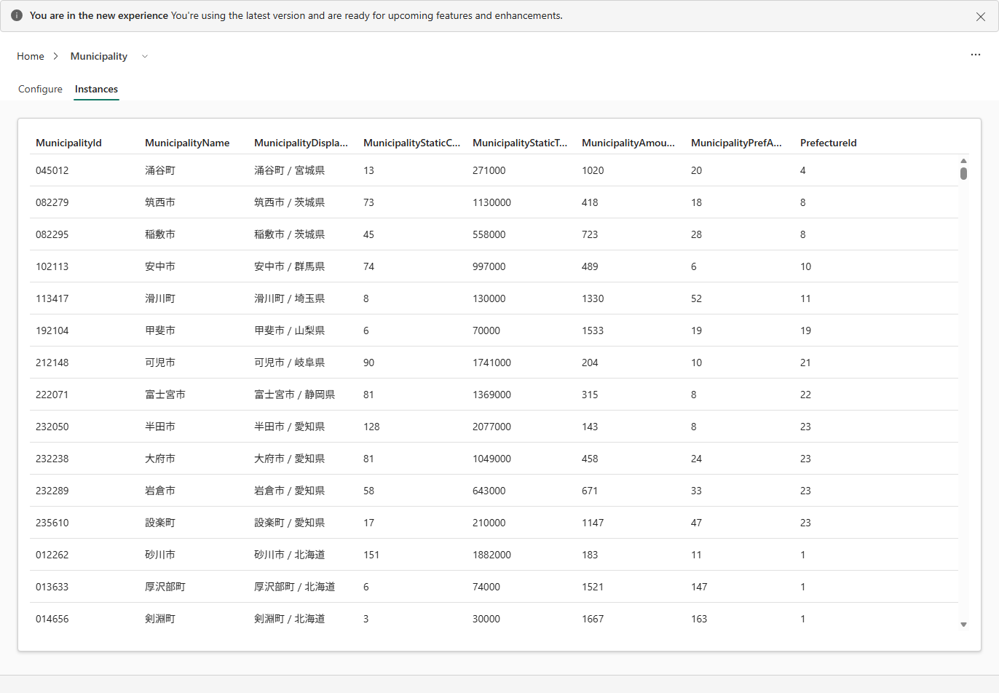

# 6.2 操作手順（3）

[Lab 目次](../README.md) · [この章の目次](README.md)

4. Entity type key を設定します。キーは下の表のとおり、変わらない String または Integer の列にします。MunicipalityId は先頭のゼロを含む6桁の String です。キーの無い Entity type は Graph の対象になりません。
5. 残りの9つの Entity type も同じ手順で作ります。表の元テーブルと Property 数に合わせ、10の Entity type の静的 Property が合計72になることを確認します。
6. Municipality の時系列 Property（IncomingDonationAmountYen）は10章でバインドします。すでに定義されている場合、この時点では Data source が Unbound と表示されますが、正常です。
7. 各 Entity type の Instances タブを開き、実際の行が表示されることを確認します。Municipality では、MunicipalityId が 045012 のように先頭のゼロ付きで表示されます。

Municipality の Instances タブ。実際の行が表示され、012262 のように ID の先頭のゼロも残っている

English

## 6.2 Steps

4. Set the Entity type key. As the table shows, the key is a stable String or Integer column. MunicipalityId is a six-character String that includes leading zeros. An entity type without a key cannot be included in a graph.
5. Create the remaining nine entity types in the same way. Follow the source table and property count in the table, and confirm that the 10 entity types have 72 static properties in total.
6. The time-series property of Municipality (IncomingDonationAmountYen) is bound in Chapter 10. If it is already defined, its Data source shows Unbound at this point; that is expected.
7. Open the Instances tab of each entity type and confirm that actual rows appear. For Municipality, MunicipalityId shows leading zeros, for example 045012.

Municipality Instances tab: actual rows from ot_municipality are listed, and leading zeros in MunicipalityId (for example 012262) are kept.

