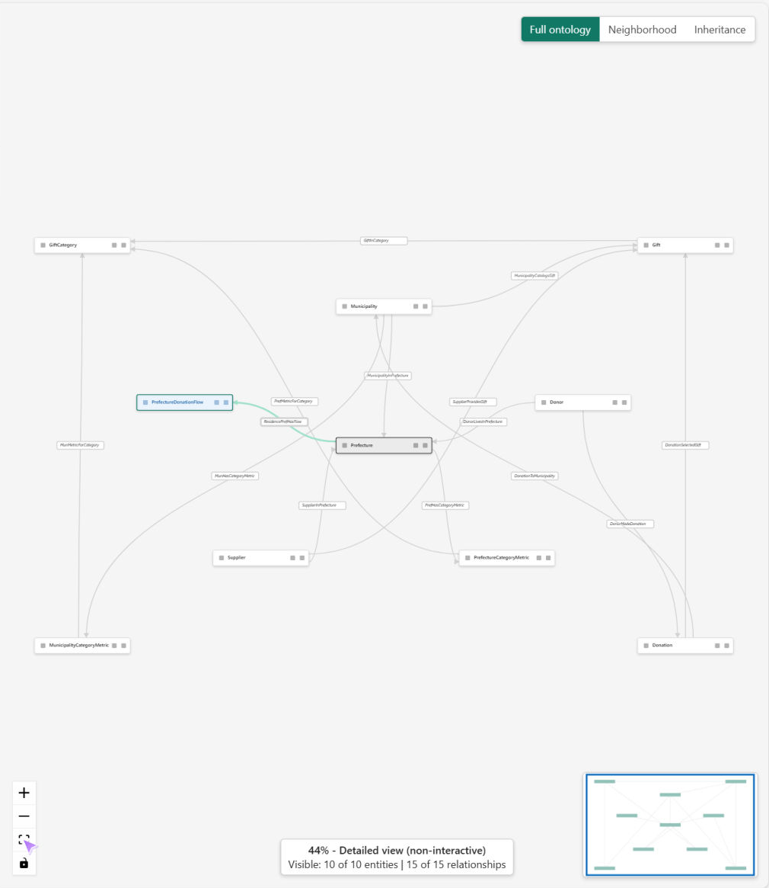

# 7.2 操作手順（1）

[Lab 目次](../README.md) · [この章の目次](README.md)

1. 最初に既存の Relationship 一覧を表と照合します。24.6で15関係が配置済みなら Add relationship・Create・Save は使わず、以降の設定を読み取り確認します。不完全な対象で関係が不足する場合だけ Home の Add relationship（または Entity type の … → Add relationship）から、表と同じ名前・Origin・Target で不足する1関係を Create します。
2. 既存の Relationship を開いて設定を確認します。外部キーで直接つなぐ関係では Use mapping table? がオフで、Origin と Target の Property が外部キーと相手側のキーに対応することを確認します。MunicipalityInPrefecture は Origin（Municipality）側が ot_municipality の PrefectureId、Target（Prefecture）側がキー PrefectureId です。新たに不足分を作成した場合だけ、この設定を入力します。
3. SupplierProvidesGift だけは Use mapping table? がオンで、ot_supplier_gift の SupplierId と GiftId がそれぞれ対応することを確認します。既存の設定は変更せず、新たに不足分を作成した場合だけ入力します。
4. 既存関係の確認では Save を押さず Cancel で閉じます。不足分を作成して実際に設定を入力した場合だけ Save を選び、成功通知を確認してから閉じます。Configure の Relationships で向きと列を読み直します。変更がなく Save が無効でも、保存のために設定を変えません。
5. 残りの関係も既存一覧と表を照合し、不完全な対象で不足するものだけを同じ手順で作成します。すべて存在すれば読み取り確認だけです。表の名前を使い、既存関係の作り直しや名前を変えた関係の追加は行いません。
6. Home の Full ontology を開き、canvas 左下の fit view（＋／−の下にある四隅アイコン）を選んで全体を表示します。Visible 件数が 10 of 10 entities | 15 of 15 relationships になることを確認します。Visible の件数は表示範囲や拡大率で変わり、一部が見えないだけでは定義が不足しているとは限りません。既存の関係一覧と表を照合し、15の Relationship の存在・向き・両側のキー列を読み取り確認します。関係を作り直したり Save したりしません。

Home の Full ontology で fit view を選んだネイティブ画面。Visible は 10 of 10 entities | 15 of 15 relationships。表示件数は表示範囲や拡大率で変わります。各関係の存在・向き・両側のキーは別途読み取り確認してください。

English

## 7.2 Steps

1. First compare the existing relationship list with the table. If all fifteen were deployed in 24.6, do not use Add relationship, Create or Save; inspect the settings below read-only. Only when a relationship is missing from an incomplete target, use Home → Add relationship (or the entity type's … menu) and Create that missing relationship with the exact listed name, origin and target.
2. Open an existing relationship and inspect its settings. For a direct foreign-key relationship, verify “Use mapping table?” is off and the origin and target properties match the foreign key and the other entity's key. MunicipalityInPrefecture uses ot_municipality.PrefectureId on the origin Municipality side and key PrefectureId on the target Prefecture side. Enter these settings only for a newly created missing relationship.
3. For SupplierProvidesGift only, set “Use mapping table?” to On; map SupplierId and GiftId from ot_supplier_gift to the corresponding entity keys. Inspect existing settings without changing them; enter them only for a newly created missing relationship.
4. For an existing relationship inspection, close with Cancel without saving. Select Save only after entering settings for a newly created missing relationship, confirm success, then close. Read back the direction and columns in Configure → Relationships. If Save is disabled because nothing changed, do not edit settings merely to enable it.
5. Compare the remaining relationships with the table and create only missing ones in an incomplete target. If all exist, inspect only. Use the listed names; do not recreate existing relationships or add renamed variants.
6. Open Full ontology on Home, then select fit view at the canvas lower left (the four-corner icon below + and −) to show the whole graph. Confirm the Visible count reads 10 of 10 entities | 15 of 15 relationships. Visible counts depend on the viewport and zoom; a partial view alone does not mean definitions are missing. Reconcile the existing relationship list with the table and inspect the existence, direction and keys on both sides of all 15 relationships read-only. Do not recreate relationships or Save.

Native Home Full ontology view after selecting fit view. Visible reads 10 of 10 entities | 15 of 15 relationships. Counts vary with the viewport and zoom; separately inspect each relationship’s existence, direction and keys on both sides.

