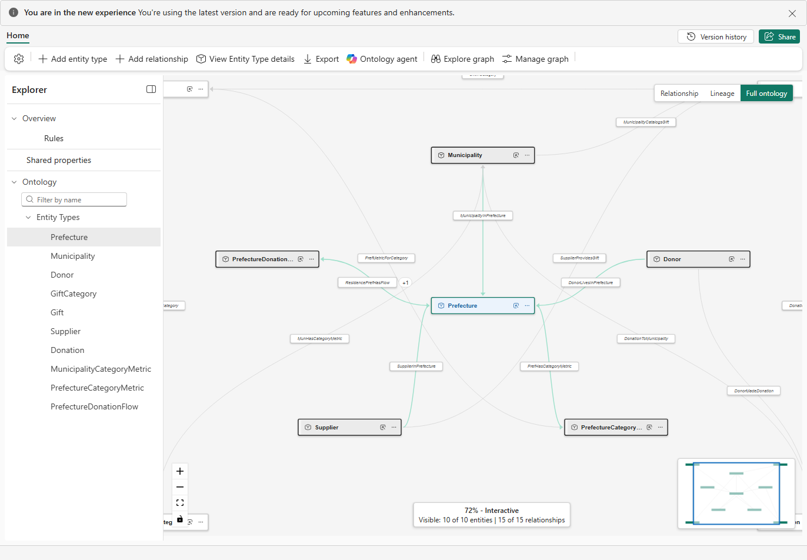

# 7.2 操作手順（1）

[Lab 目次](../README.md) · [この章の目次](README.md)

1. Home の Add relationship（または Explorer で Entity type の名前の横の … → Add relationship）を選びます。Add new relationship の画面で、表のとおりの名前、Origin entity type、Target entity type を入力して Create を選びます。
2. 作成した Relationship を開きます。外部キーで直接つなぐ関係では Use mapping table? をオフのままにし、Origin と Target の Property で、外部キーの列と相手側のキーを対応させます。例：MunicipalityInPrefecture では、Origin（Municipality）側で ot_municipality の PrefectureId を、Target（Prefecture）側でキーの PrefectureId を選びます。
3. SupplierProvidesGift だけは Use mapping table? をオンにして ot_supplier_gift を選び、SupplierId と GiftId をそれぞれ対応させます。
4. Save を選び、成功の通知を確認してから Cancel で閉じます。Configure の Relationships を開き直し、向きと列が表のとおりかを確認します。
5. 残りの Relationship も同じ手順で作ります。同じ名前は登録できないため、表の名前をそのまま使い、名前を変えた関係を増やしません。
6. Home で、10の Entity type と15の Relationship がすべて表示されることを確認します（Visible: 10 of 10 entities | 15 of 15 relationships）。

Relationship を作成した後の Home。グラフの下に Visible: 10 of 10 entities | 15 of 15 relationships と表示される

English

## 7.2 Steps

1. Select Add relationship on Home (or … → Add relationship next to an entity type name in Explorer). In the Add new relationship window, enter the name, Origin entity type and Target entity type exactly as in the table, then select Create.
2. Open the new relationship. For a direct foreign-key relationship, leave Use mapping table? off and use the origin and target Property fields to match the foreign-key column with the key on the other side. For example, for MunicipalityInPrefecture select PrefectureId of ot_municipality on the origin (Municipality) side and the key PrefectureId on the target (Prefecture) side.
3. Only for SupplierProvidesGift, turn on Use mapping table?, choose ot_supplier_gift and map SupplierId and GiftId respectively.
4. Select Save, confirm the success notification and close with Cancel. Reopen Relationships in Configure and check that the direction and columns match the table.
5. Create the remaining relationships in the same way. A name cannot be registered twice, so use the names in the table exactly and do not add renamed variants.
6. On Home, confirm that all 10 entity types and 15 relationships are shown (Visible: 10 of 10 entities | 15 of 15 relationships).

Ontology Home after creating the relationships: the status under the graph reads Visible: 10 of 10 entities | 15 of 15 relationships.

