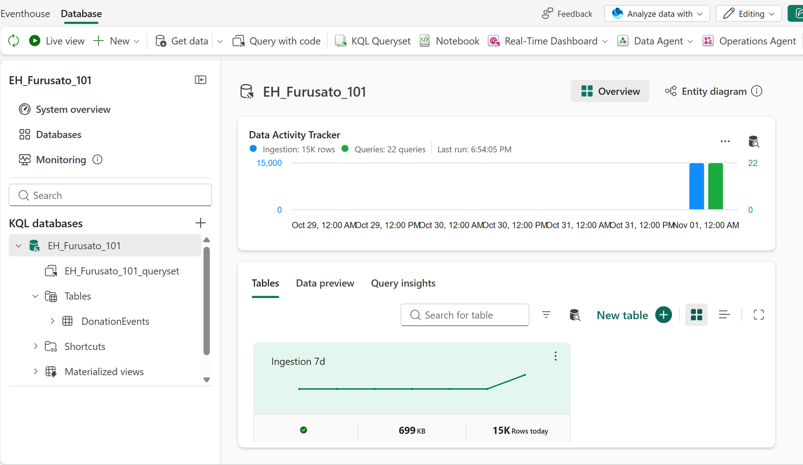

# 8.2 操作手順（1）

[Lab 目次](../README.md) · [この章の目次](README.md)

1. KQL Database に対して KQL Queryset を開きます。
2. DonationEvents テーブルがすでにあるかを確認します。講師の配置などで作成済みの場合は、定義を確認するだけにして、コマンドを再実行しません。
3. 現在供給されている共有ワークスペースでは、既存テーブルやデータに対する書き込み・再設定・取り込みを行いません。テーブルの存在と定義は読み取りで確認し、OneLake の内容は10章の KQL 結果とは分けて照合します。

実際の KQL Database overview。DonationEvents が Explorer にあり、画面上は丸め表示で 15K rows と示されます。ナビゲーション用の図であり、正確な件数、OneLake Delta の materialization、source reconciliation の証明ではありません。

English

## 8.2 Steps

1. Open a KQL queryset for the KQL database.
2. Check whether the DonationEvents table already exists. If it was already created (for example by the instructor's deployment), only review its definition and do not rerun the commands.
3. In the currently supplied shared workspace, do not write to, reconfigure or ingest into existing tables or data. Check table existence and definition read-only, and reconcile OneLake contents separately from the KQL results in Chapter 10.

Actual KQL Database overview with DonationEvents in Explorer and a rounded 15K rows display. This is a navigation illustration, not proof of an exact count, OneLake Delta materialization or source reconciliation.

