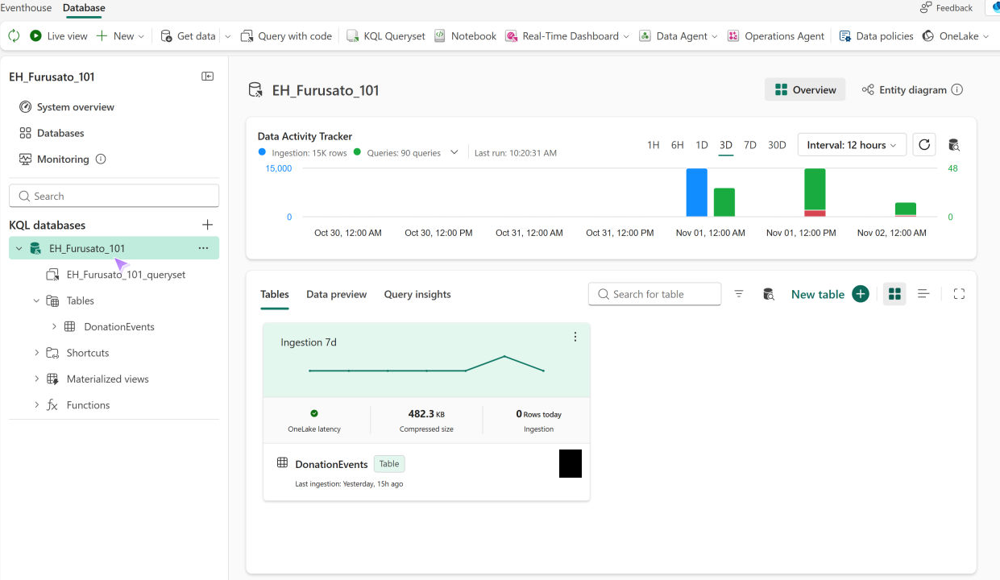

# 8.2 操作手順（1）

[Lab 目次](../README.md) · [この章の目次](README.md)

1. KQL Database に対して KQL Queryset を開きます。
2. DonationEvents テーブルがすでにあるかを確認します。講師の配置などで作成済みの場合は、定義を確認するだけにして、コマンドを再実行しません。
3. 現在供給されている共有ワークスペースでは、既存テーブルやデータに対する書き込み・再設定・取り込みを行いません。テーブルの存在と定義は読み取りで確認し、OneLake の内容は10章の KQL 結果とは分けて照合します。

現在の KQL Database overview。Explorer に DonationEvents が表示されます。Data Activity Tracker は 3D の表示期間で、Ingestion は丸め表示の 15K rows です。別期間の Rows today は 0。15K は正確な総数ではなく、この図は実行、新規データの materialization、table mirror、source reconciliation の証拠ではありません。

English

## 8.2 Steps

1. Open a KQL queryset for the KQL database.
2. Check whether the DonationEvents table already exists. If it was already created (for example by the instructor's deployment), only review its definition and do not rerun the commands.
3. In the currently supplied shared workspace, do not write to, reconfigure or ingest into existing tables or data. Check table existence and definition read-only, and reconcile OneLake contents separately from the KQL results in Chapter 10.

Current KQL Database overview: Explorer shows DonationEvents. Data Activity Tracker is set to 3D; Ingestion shows a rounded 15K rows. Rows today is 0 for a separate interval. 15K is not an exact total; this overview is not evidence of a fresh execution, new-data materialization, table mirroring or source reconciliation.

