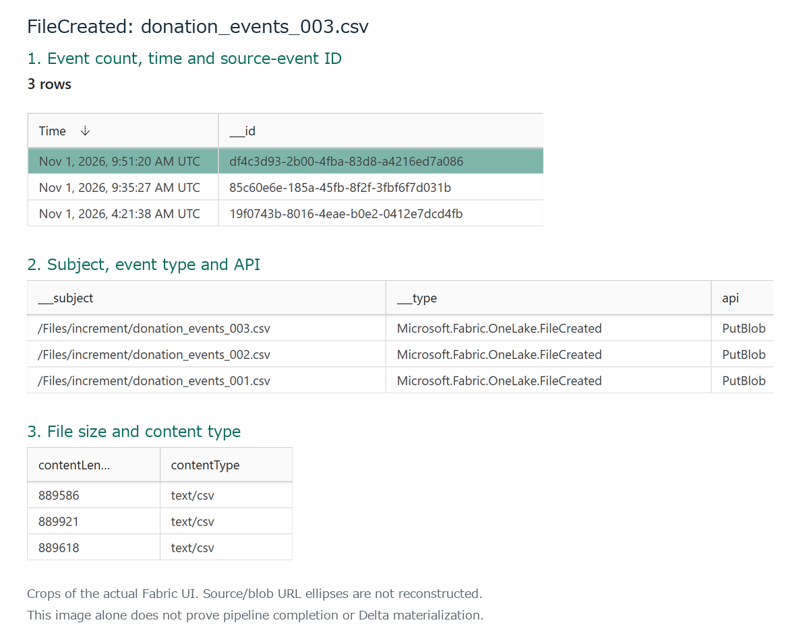

# 9.2 操作手順（1）

[Lab 目次](../README.md) · [この章の目次](README.md)

1. アップロード前に、8章と24.6で DonationEvents だけの mirroring（parquet、IsEnabled=true、TargetLatencyInMinutes=5）と所有範囲・schema・RLS の確認が通っていることを確認します。未確認ならファイルを置かず停止します。取り込み後の有効化を、過去行の公開が済んだこととして扱いません。
2. Pipeline を開き、Copy data1 の設定を確認します。コピー元は Lakehouse の Files にある increment フォルダー、コピー先は KQL Database の DonationEvents、取り込みマッピングは DonationEvents_IncrementCsvMap です。パラメーターは IncrementFileName、Type、Subject、Source の4つです。ファイル名は次の式で決まります（Subject の最後の部分。Subject が空のときは IncrementFileName）。ここでは Pipeline を手動で実行しません。

**Pipeline expression**

```text
@if(empty(pipeline().parameters.Subject), pipeline().parameters.IncrementFileName, last(split(pipeline().parameters.Subject, '/')))
```

3. Activator でルールが停止していることを確認してから、ルールを開いて Edit action を選びます。実行先がこの Pipeline であること、Type・Subject・Source がイベントの値に対応付けられていることを確認し、Apply、続けて Save を1回だけ選びます。履歴のイベントには適用せず、Advanced settings の遅れて到着するイベントの待機時間を2分にします。配布時の設定値だけでは、アクションの認証が使えることを確認できません。
4. ルールの監視対象が FileCreated と /Files/increment に限られていることを確認し、24.7の start-activator と check-activator-readiness を順に実行します。自分で処理側の Running、設定の同期、正常な health、アクション認証の Initialized を確認してから次へ進みます。24.7で開始済みなら開始を繰り返さず、読み取り確認だけを実施します。まだ準備中ならファイルを置かずに待ちます。
5. Lakehouse の Files/increment に donation_events_001.csv を1回だけアップロードします。002 と 003 はまだ置きません。同じファイルを重ねて置いたり、空のファイルを作ってから書き込んだりしません。
6. Activator でイベントソースの Live feed を開き、実際に確認できる /Files/increment/donation_events_001.csv の FileCreated 行を記録します。この行はイベント観測だけを示し、Pipeline の完了、KQL 取り込み、OneLake Delta の内容を証明しません。添付図は donation_events_003.csv のイベント行を示し、最大3行が表示される場合があります。図を001の証拠として扱わず、対象の実際の行を確認します。



実際のイベントソース画面の観測値。3件の FileCreated が並び、選択行は donation_events_003.csv、Microsoft.Fabric.OneLake.FileCreated、PutBlob です。イベントの観測であり、Pipeline 完了や Delta への materialization を示しません。

<details>
<summary>English</summary>

## 9.2 Steps

1. Before uploading, confirm that Chapters 8 and 24.6 verified DonationEvents-only mirroring (parquet, IsEnabled=true, TargetLatencyInMinutes=5), ownership scope, schema and RLS. If unverified, stop without uploading. Enabling after ingestion does not establish that historical rows have been published.
2. Open the Pipeline and check the settings of Copy data1. The source is the increment folder in the Lakehouse Files, the destination is DonationEvents in the KQL database, and the ingestion mapping is DonationEvents_IncrementCsvMap. There are four parameters: IncrementFileName, Type, Subject and Source. The file name is determined by the following expression (the last segment of Subject, or IncrementFileName when Subject is empty). Do not run the Pipeline manually here.

**Pipeline expression**

```text
@if(empty(pipeline().parameters.Subject), pipeline().parameters.IncrementFileName, last(split(pipeline().parameters.Subject, '/')))
```

3. In the Activator, confirm that the rule is stopped, open the rule and select Edit action. Confirm that the target is this Pipeline and that Type, Subject and Source are mapped to event values, then select Apply and then Save, once. Keep historical application off and set the wait for late-arriving events in Advanced settings to two minutes. The distributed settings alone do not confirm that the action credentials are usable.
4. Confirm that the rule watches only FileCreated under /Files/increment, then run start-activator and check-activator-readiness in 24.7. Inspect backend Running, synchronized settings, healthy state and Initialized action credentials yourself before continuing. If already started in 24.7, repeat only the read check. If not ready, wait without uploading.
5. Upload donation_events_001.csv to Files/increment in the Lakehouse, once. Do not add 002 or 003 yet. Never upload the same file again, and never create an empty file and write into it later.
6. Open the event source Live feed in Activator and record the actual FileCreated row for /Files/increment/donation_events_001.csv if present. This row is an event observation only; it does not prove Pipeline completion, KQL ingestion or OneLake Delta contents. The figure depicts an event row for donation_events_003.csv and may show up to three rows. Do not treat it as evidence for 001; verify the actual target row.


Observed values from the actual event-source view. Three FileCreated rows are listed; the selected row is donation_events_003.csv with Microsoft.Fabric.OneLake.FileCreated and PutBlob. This shows an event, not Pipeline completion or Delta materialization.

</details>
