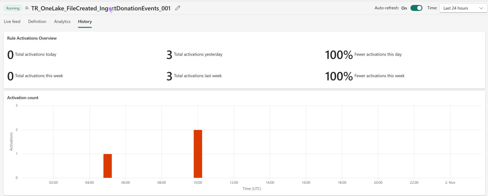

# 9.2 操作手順（2）

[Lab 目次](../README.md) · [この章の目次](README.md)

7. ルールの History で activation が記録され、Subject が /Files/increment/donation_events_001.csv、Type が Microsoft.Fabric.OneLake.FileCreated になっていることを確認します。

ルールの History タブ。Activation details に、起動のもとになったファイルのパスと FileCreated が表示される（図は 002 と 003 の2件）

English

## 9.2 Steps

7. In the rule's History, confirm that an activation is recorded with Subject /Files/increment/donation_events_001.csv and Type Microsoft.Fabric.OneLake.FileCreated.

Rule History tab: Activation details list the path of each file that triggered the rule and the FileCreated type (the figure shows files 002 and 003).

