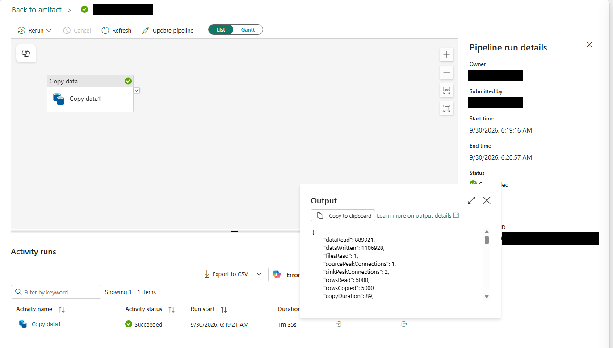

# 9.2 操作手順（3）

[Lab 目次](../README.md) · [この章の目次](README.md)

8. Pipeline の実行履歴（Recent runs）で、対象Pipelineの実行IDと開始・終了時刻（タイムゾーン付き）、実際の IncrementFileName・Type・Subject・Source を記録します。Subject の末尾（空なら IncrementFileName）が donation_events_001.csv であり、Type・Subject・Source が直前の FileCreated とルールの activation に一致することを確認します。イベントと activation の識別情報・時刻を実行ID・時刻に対応付けて保存し、その同じ実行が Succeeded、Copy data1 の Output の rowsRead と rowsCopied が 5000 であることを確認します。新しい Succeeded や行数だけでは対象ファイルの自動実行を証明できません。対応を確認できない場合は未確認と記録し、同じファイルを再送しません。

Pipeline の実行の Copy data1 の Output。Succeeded で、rowsRead と rowsCopied がともに 5000（1ファイル分）

English

## 9.2 Steps

8. In Pipeline Recent runs, record the target Pipeline's run ID, start/end times with time zone, and actual IncrementFileName, Type, Subject and Source parameters. Confirm that the last segment of Subject (or IncrementFileName if Subject is empty) is donation_events_001.csv and that Type, Subject and Source match the preceding FileCreated event and rule activation. Retain the event and activation identities/times correlated with that run ID and its times, then confirm that this same run Succeeded and its Copy data1 Output has rowsRead and rowsCopied of 5000. A recent Succeeded status or row count alone does not prove automatic processing of this file. If correlation cannot be established, record it as unverified and do not upload the file again.

Output of Copy data1 in a Pipeline run: the activity Succeeded, and rowsRead and rowsCopied are both 5000 for one file.

