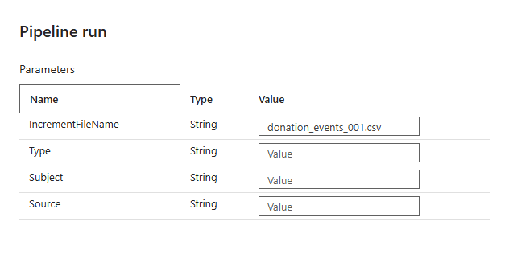

# 9.2 操作手順（4）

[Lab 目次](../README.md) · [この章の目次](README.md)

8. KQL Queryset で、次のクエリの &lt;SourceFile&gt; を donation_events_001.csv に置き換えて（二重引用符は残します）実行し、5,000行、合計 85,098,000円、EventID の欠落が0であることを確認します。

**KQL**

```kql
let targetSourceFile = "<SourceFile>";
DonationEvents
| where SourceFile == targetSourceFile
| summarize
    Rows=count(),
    DistinctEventIDs=count_distinct(EventID),
    MissingEventIDs=countif(isempty(EventID)),
    DistinctDonationIDs=count_distinct(DonationID),
    TotalDonationAmountYen=sum(DonationAmountYen),
    FirstDonatedAtUtc=min(DonatedAt),
    LatestDonatedAtUtc=max(DonatedAt)
```

9. 送信後は履歴を読み取り、遅延を見込んで待ちます。公式の目安は最大10分で、今回の遅延待機は最低2分です。開始前に確認期限を記録し、期限まで activation がなければ再アップロードせず24.7の stop-activator で停止し、イベント・実行履歴・件数を確認します。取り込み済みか不明なまま手動 Pipeline を重ねません。手動回復を選ぶ場合は、先行処理の終了と対象ファイル未取込を確認して1回だけ実行し、元の失敗を保持して「手動」と記録します。Parameters の IncrementFileName はファイル名、Type・Subject・Source は空欄です。



講師の指示で手動実行するときの Parameters。IncrementFileName にファイル名を入力し、Type・Subject・Source は空のまま

> Pipeline は重複を除きません。同じファイルを2回取り込むと、行が2倍になります。

> Ontology の Business Rules を設定しても、Activator は動きません。ファイルの到着で動くのは、この章のルールだけです。

<details>
<summary>English</summary>

## 9.2 Steps

8. In the KQL queryset, replace &lt;SourceFile&gt; in the following query with donation_events_001.csv (keep the double quotes) and run it. Confirm 5,000 rows, a total of JPY 85,098,000 and zero missing EventIDs.

**KQL**

```kql
let targetSourceFile = "<SourceFile>";
DonationEvents
| where SourceFile == targetSourceFile
| summarize
    Rows=count(),
    DistinctEventIDs=count_distinct(EventID),
    MissingEventIDs=countif(isempty(EventID)),
    DistinctDonationIDs=count_distinct(DonationID),
    TotalDonationAmountYen=sum(DonationAmountYen),
    FirstDonatedAtUtc=min(DonatedAt),
    LatestDonatedAtUtc=max(DonatedAt)
```

9. Read history after submission and allow for latency. Published guidance is up to ten minutes; this rule’s late-arrival wait is at least two minutes. Record a deadline beforehand. If no activation appears by then, do not upload again: stop with stop-activator in 24.7 and inspect events, run history and counts. Do not overlap a manual Pipeline while ingestion is uncertain. If choosing manual recovery, first establish that prior processing ended and the file was not ingested, then run once, retaining the failure and labeling the ingestion manual. Set IncrementFileName to the filename and leave Type, Subject and Source empty.


Parameters for a manual run on the instructor's instruction: enter the file name in IncrementFileName and leave Type, Subject and Source empty.

> The Pipeline does not remove duplicates. Ingesting the same file twice doubles the rows.

> Setting ontology Business Rules does not trigger the Activator. Only the rule in this chapter reacts to file arrivals.

</details>
