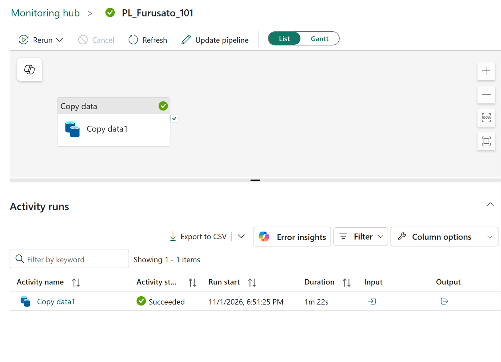

# 10.2 操作手順（1）

[Lab 目次](../README.md) · [この章の目次](README.md)

1. 現在供給されている共有ワークスペースでは、以下のアップロードや書き込みを行わず、読み取りと差分の記録だけにします。参加者自身が所有する新規ターゲットで、全ての事前証拠がそろい、空の状態が確認できた場合に限り、002・003を1本ずつアップロードして9章と同じ順で検証します。002 の期待値は5,000行・84,687,000円です。
2. 002 の確認が終わってから donation_events_003.csv をアップロードし、同じように確認します（5,000行・84,101,000円）。
3. 003 の Pipeline Recent runs と Copy の実際の状態を読み取り、実行 ID と対象ファイルを確認します。添付図は Pipeline/Copy の成功状態だけを示す例です。003 とのソース対応、読み書き行数・バイト数、自動起動、KQL の合計は証明しません。これらは実際のパラメーター・イベント/activation・Copy 出力・KQL 結果で個別に照合し、確認できないものは未確認と記録します。

実際の PL_Furusato_101 の実行画面。1件の Pipeline 実行と Copy data1 が Succeeded です。この画面だけでは、対象ファイルとの対応、行数・バイト数、自動起動、KQL の合計は証明されません。

English

## 10.2 Steps

1. In the currently supplied shared workspace, do not perform the uploads or writes below; read and record the gap only. Only on a new target owned by the participant, after all prerequisite evidence is complete and the target is confirmed empty, upload 002 and 003 one at a time and verify them in the Chapter 9 sequence. The expected 002 values are 5,000 rows / JPY 84,687,000.
2. After 002 is confirmed, upload donation_events_003.csv and check it in the same way (5,000 rows and JPY 84,101,000).
3. Read the actual Pipeline Recent runs and Copy status for 003, and check the run ID and target file. The figure illustrates a successful Pipeline/Copy status only. It does not prove source association with 003, rows/bytes, automatic triggering or KQL totals. Reconcile those separately using actual parameters, event/activation, Copy output and KQL results; record anything not verified as unverified.

Actual PL_Furusato_101 run view showing one successful Pipeline run and Copy data1. This screen alone does not prove which source file it processed, row or byte counts, automatic triggering or KQL totals.

