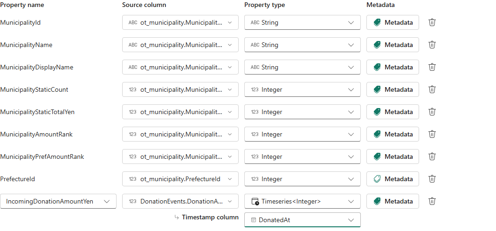

# 10.2 操作手順（2）

[Lab 目次](../README.md) · [この章の目次](README.md)

4. 3ファイルの確認が終わったら、24.7の stop-activator を1回実行し、実行中の Pipeline が無いことを確認します。停止済みなら状態を確認するだけにします。
5. KQL の集計ビューの実測値を記録します。DonationEvents の全体は ObservationCount 15,000、ObservedAmountYen 253,886,000円で、最初の観測は 2026-08-01T00:02:47Z、最後は 2026-08-31T23:58:20Z です。この KQL 結果を OneLake Delta の完全性の証拠にしません。

**KQL**

```kql
DonationObservationSummaryForAgent
| summarize
    ObservationCount=sum(ObservationCount),
    ObservedAmountYen=sum(ObservedAmountYen),
    FirstObservedAt=min(FirstObservedAt),
    LastObservedAt=max(LastObservedAt)
```

6. EventID の一意な件数を正確に数えます。結果は 14,900 です。近似値を返す dcount は使いません。

**KQL**

```kql
DonationEvents
| summarize by EventID
| count
```

7. 重複の件数を数えます。結果は 100 です。重複を除いた金額は 252,058,000円で、重複を含む 253,886,000円とは別の値です。

**KQL**

```kql
DonationEvents
| summarize Rows=count() by EventID
| summarize DuplicateRows=sum(Rows - 1)
```

8. 日ごとの分布を確認します。UTC で 2026-08-01〜08-31 の31日すべてに行があり、1日 450〜582行です。2026-08-11 が 582行と多いのは、重複がこの日に集中しているためです。

**Readable wrapped view — KQL**

<div>
DonationEvents<br>
| summarize Rows=count(), TotalYen=sum(DonationAmountYen) by UtcDay=bin(DonatedAt, 1d)<br>
| order by UtcDay asc
</div>

**Verbatim source follows; copy from the canonical block.**

**KQL**

```kql
DonationEvents
| summarize Rows=count(), TotalYen=sum(DonationAmountYen) by UtcDay=bin(DonatedAt, 1d)
| order by UtcDay asc
```

9. 現在供給されている共有ワークスペースの DonationEvents OneLake Delta active Parquet は、fixture 002 と 003 の和集合だけです。SourceFile・EventID・金額の多重度で照合した実測値は10,000件・168,788,000円です。3つの fixture 全体と比べると source 固有の5,000行が欠けており、001 と002に共通する100行があるため、欠落 EventID は4,900件です。これは部分エクスポートであり、全件バックフィルではありません。KQL の3ファイル計15,000行・253,886,000円とは別の実測結果です。ここでは読み取りと差分の記録だけを行い、書き込み、修復、retry、toggle、reset、replay、backfill は行いません。
10. 以下の Ontology 操作は、参加者自身が所有するターゲットで、Delta が3つの fixture 全体と SourceFile・EventID・金額の多重度まで完全一致し、KQL と照合済みの場合だけ実施します。現在供給されている共有ワークスペースでは、部分 Delta が停止条件です。Ontology の binding や Property を追加・変更・保存せず、読み取りと差分記録だけにしてください。新規の参加者所有ターゲットでも、8章の安全確認と空の状態を確認してから進みます。
11. 上記の全条件を満たす参加者所有ターゲットに限り、Ontology で Municipality を開き、Configure → Manage property bindings → Add binding and properties を選びます。EH_Furusato_&lt;PID&gt; の DonationEvents テーブルを追加します（ビューの DonationObservationSummaryForAgent は選びません）。共通列として DonationEvents の MunicipalityID と Municipality の MunicipalityId を対応させ、Save します。共有ワークスペースではこの書き込みを行いません。
12. 同じく、全条件を満たす参加者所有ターゲットに限り、Entity type properties で IncomingDonationAmountYen に DonationEvents.DonationAmountYen を対応させます（既存 Property があればそれを選び、無い場合だけ作成）。型は Timeseries&lt;Integer&gt;、Timestamp column は DonatedAt（UTC）とし、別名 Property を作らず保存前後の一覧を比べます。現在の共有ワークスペースでは Property の追加・変更・保存をしません。



時系列 Property の binding definition 画面。型と Timestamp column の設定例を示しますが、読み取り可能な source data、実行可能性、native query や GQL の成功を証明するものではありません。

<details>
<summary>English</summary>

## 10.2 Steps

4. After verifying all three files, run stop-activator in 24.7 once and confirm that no Pipeline is running. If already stopped, only inspect its state.
5. Record the observed KQL summary-view results. DonationEvents totals ObservationCount 15,000 and ObservedAmountYen JPY 253,886,000, with first observation 2026-08-01T00:02:47Z and last observation 2026-08-31T23:58:20Z. Do not use this KQL result as evidence of complete OneLake Delta contents.

**KQL**

```kql
DonationObservationSummaryForAgent
| summarize
    ObservationCount=sum(ObservationCount),
    ObservedAmountYen=sum(ObservedAmountYen),
    FirstObservedAt=min(FirstObservedAt),
    LastObservedAt=max(LastObservedAt)
```

6. Count unique EventIDs exactly. The result is 14,900. Do not use dcount, which returns an approximation.

**KQL**

```kql
DonationEvents
| summarize by EventID
| count
```

7. Count the duplicates. The result is 100. The amount without duplicates is JPY 252,058,000, which differs from JPY 253,886,000 including duplicates.

**KQL**

```kql
DonationEvents
| summarize Rows=count() by EventID
| summarize DuplicateRows=sum(Rows - 1)
```

8. Check the daily distribution. Every one of the 31 UTC days from 2026-08-01 to 08-31 has rows, with 450 to 582 rows per day. 2026-08-11 has 582 rows because the duplicates are concentrated on that day.

**Readable wrapped view — KQL**

<div>
DonationEvents<br>
| summarize Rows=count(), TotalYen=sum(DonationAmountYen) by UtcDay=bin(DonatedAt, 1d)<br>
| order by UtcDay asc
</div>

**Verbatim source follows; copy from the canonical block.**

**KQL**

```kql
DonationEvents
| summarize Rows=count(), TotalYen=sum(DonationAmountYen) by UtcDay=bin(DonatedAt, 1d)
| order by UtcDay asc
```

9. The DonationEvents OneLake Delta active Parquet in the currently supplied shared workspace is exactly the union of fixtures 002 and 003. Exact SourceFile/EventID/amount multiplicity reconciliation gives 10,000 records / JPY 168,788,000. Against all three fixtures, 5,000 source-specific rows are missing; because 001 and 002 share 100 rows, 4,900 distinct EventIDs are missing. This is a partial export, not a full backfill. It is a separate observed result from KQL's 15,000 rows / JPY 253,886,000 across all three files. Read and record the gap only; do not write, repair, retry, toggle, reset, replay or backfill.
10. Perform the following ontology operations only on a participant-owned target whose Delta exactly reconciles to all three fixtures by SourceFile/EventID/amount multiplicity and has been reconciled with KQL. The partial Delta in the currently supplied shared workspace is a stop condition: do not add, change or save ontology bindings or properties there; read and record the gap only. On a new participant-owned target, also complete the Chapter 8 safety checks and confirm the empty state before proceeding.
11. Only on a participant-owned target that meets all the conditions above, open Municipality in the ontology and select Configure → Manage property bindings → Add binding and properties. Add the DonationEvents table of EH_Furusato_&lt;PID&gt; (not DonationObservationSummaryForAgent), map DonationEvents.MunicipalityID to Municipality.MunicipalityId, and Save. Do not make this write in the shared workspace.
12. Again, only on a participant-owned target meeting all conditions above, map DonationEvents.DonationAmountYen to IncomingDonationAmountYen under Entity type properties (select an existing property, creating it only if absent). Use Timeseries&lt;Integer&gt; with DonatedAt (UTC) as the timestamp column, avoid duplicate properties and compare the lists before and after saving. Do not add, change or save properties in the currently supplied shared workspace.


Time-series property binding-definition screen showing example type and timestamp-column settings. It does not prove readable source data, runtime availability, a native query or GQL success.

</details>
