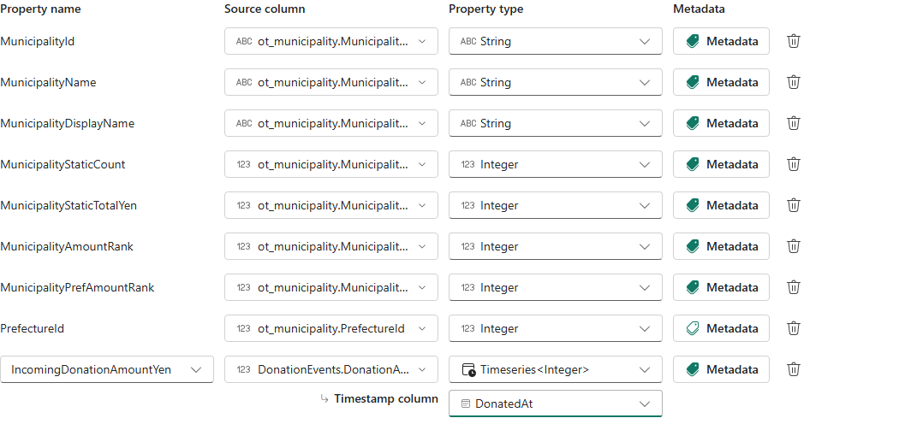

# 10.2 操作手順（2）

[Lab 目次](../README.md) · [この章の目次](README.md)

4. 3ファイルの確認が終わったら、24.7の stop-activator を1回実行し、実行中の Pipeline が無いことを確認します。停止済みなら状態を確認するだけにします。
5. KQL の集計ビューの実測値を記録します。DonationEvents の全体は ObservationCount 15,000、ObservedAmountYen 253,886,000円で、最初の観測は `2026-08-01T00:02:47Z`、最後は `2026-08-31T23:58:20Z` です。この KQL 結果を OneLake Delta の完全性の証拠にしません。

**KQL**

```kql
DonationObservationSummaryForAgent
| summarize
    ObservationCount=sum(ObservationCount),
    ObservedAmountYen=sum(ObservedAmountYen),
    FirstObservedAt=min(FirstObservedAt),
    LastObservedAt=max(LastObservedAt)
```

6. EventID の一意な件数を正確に数えます。結果は 14,900 です。近似値を返す dcount は使いません。

**KQL**

```kql
DonationEvents
| summarize by EventID
| count
```

7. 重複の件数を数えます。結果は 100 です。重複を除いた金額は 252,058,000円で、重複を含む 253,886,000円とは別の値です。

**KQL**

```kql
DonationEvents
| summarize Rows=count() by EventID
| summarize DuplicateRows=sum(Rows - 1)
```

8. 日ごとの分布を確認します。UTC で 2026-08-01〜08-31 の31日すべてに行があり、1日 450〜582行です。2026-08-11 が 582行と多いのは、重複がこの日に集中しているためです。

**Readable wrapped view — KQL**

<div>
DonationEvents<br>
| summarize Rows=count(), TotalYen=sum(DonationAmountYen) by UtcDay=bin(DonatedAt, 1d)<br>
| order by UtcDay asc
</div>

**Verbatim source follows; copy from the canonical block.**

**KQL**

```kql
DonationEvents
| summarize Rows=count(), TotalYen=sum(DonationAmountYen) by UtcDay=bin(DonatedAt, 1d)
| order by UtcDay asc
```

9. 自分の DonationEvents OneLake Delta を、3つの配布 CSV と SourceFile・EventID・金額ごとに照合します。行の不足、余分な行、または不明な点があれば記録して停止します。KQL の集計結果と Delta の内容は別々に確認します。所有者の承認なしに書き込みや再処理を行いません。
10. 以下の Ontology 操作は、自分が所有し操作の承認を得た対象で、Delta が3つの配布 CSV 全体と SourceFile・EventID・金額の多重度まで完全一致し、KQL と照合済みの場合だけ実施します。部分的、未照合、または状態を確認できない場合は停止し、Ontology の binding や Property を追加・変更・保存せず、読み取りと差分記録だけにします。8章の安全確認も済ませてから進みます。
11. 上記の全条件を満たす参加者所有ターゲットに限り、Ontology で Municipality を開きます。Configure に Manage property bindings が表示される場合はそれを開きます。表示されず Configure の toolbar に Bind data がある場合は Bind data を選びます。実際に表示される入口だけを使います。どちらの入口でも、EH_Furusato_&lt;PID&gt; の DonationEvents テーブル（ビューの DonationObservationSummaryForAgent は除く）を選び、DonationEvents の MunicipalityID と Municipality の MunicipalityId を対応させて Save します。どちらも表示されない場合、または追加画面で source table・key・columns を確認できない場合は、何も作成・保存せず停止して講師に確認します。
12. 同じく、全条件を満たす対象に限り、Entity type properties で既存の IncomingDonationAmountYen に DonationEvents.DonationAmountYen を対応させます。既存 Property がない場合だけ作成し、型は Timeseries&lt;Integer&gt;、Timestamp column は DonatedAt（UTC）にします。別名 Property を作らず、保存前後の一覧を比べます。



時系列 Property の binding definition 画面。型と Timestamp column の設定例を示しますが、読み取り可能な source data、実行可能性、native query や GQL の成功を証明するものではありません。

<details>
<summary>English</summary>

## 10.2 Steps

4. After verifying all three files, run stop-activator in 24.7 once and confirm that no Pipeline is running. If already stopped, only inspect its state.
5. Record the observed KQL summary-view results. DonationEvents totals ObservationCount 15,000 and ObservedAmountYen JPY 253,886,000, with first observation `2026-08-01T00:02:47Z` and last observation `2026-08-31T23:58:20Z`. Do not use this KQL result as evidence of complete OneLake Delta contents.

**KQL**

```kql
DonationObservationSummaryForAgent
| summarize
    ObservationCount=sum(ObservationCount),
    ObservedAmountYen=sum(ObservedAmountYen),
    FirstObservedAt=min(FirstObservedAt),
    LastObservedAt=max(LastObservedAt)
```

6. Count unique EventIDs exactly. The result is 14,900. Do not use dcount, which returns an approximation.

**KQL**

```kql
DonationEvents
| summarize by EventID
| count
```

7. Count the duplicates. The result is 100. The amount without duplicates is JPY 252,058,000, which differs from JPY 253,886,000 including duplicates.

**KQL**

```kql
DonationEvents
| summarize Rows=count() by EventID
| summarize DuplicateRows=sum(Rows - 1)
```

8. Check the daily distribution. Every one of the 31 UTC days from 2026-08-01 to 08-31 has rows, with 450 to 582 rows per day. 2026-08-11 has 582 rows because the duplicates are concentrated on that day.

**Readable wrapped view — KQL**

<div>
DonationEvents<br>
| summarize Rows=count(), TotalYen=sum(DonationAmountYen) by UtcDay=bin(DonatedAt, 1d)<br>
| order by UtcDay asc
</div>

**Verbatim source follows; copy from the canonical block.**

**KQL**

```kql
DonationEvents
| summarize Rows=count(), TotalYen=sum(DonationAmountYen) by UtcDay=bin(DonatedAt, 1d)
| order by UtcDay asc
```

9. Reconcile your DonationEvents OneLake Delta with the three supplied CSVs by SourceFile, EventID and amount. Record any missing or extra rows, or anything you cannot verify, and stop. Check KQL summary results and Delta contents separately. Do not write or process the data again without the owner's approval.
10. Perform the following ontology operations only on a target you own and are authorized to modify, whose Delta exactly reconciles to all three supplied CSVs by SourceFile/EventID/amount multiplicity and has been reconciled with KQL. If it is partial, unreconciled or its state cannot be verified, stop; do not add, change or save ontology bindings or properties, and only read and record the gap. Complete the Chapter 8 safety checks first.
11. Only on a participant-owned target that meets all the conditions above, open Municipality in the ontology. If Configure shows Manage property bindings, open it. If it is absent and the Configure toolbar shows Bind data, select Bind data instead. Use only an entry actually shown. From either entry, select the DonationEvents table in EH_Furusato_&lt;PID&gt; (not the DonationObservationSummaryForAgent view), map DonationEvents.MunicipalityID to Municipality.MunicipalityId, and Save. If neither control is shown, or the add screen does not let you verify the source table, key and columns, stop without creating or saving and ask the instructor.
12. Again, only on a target meeting all conditions above, map DonationEvents.DonationAmountYen to the existing IncomingDonationAmountYen under Entity type properties. Create the property only if it is absent; use Timeseries&lt;Integer&gt; with DonatedAt (UTC) as the timestamp column. Avoid duplicate properties and compare the lists before and after saving.


Time-series property binding-definition screen showing example type and timestamp-column settings. It does not prove readable source data, runtime availability, a native query or GQL success.

</details>
