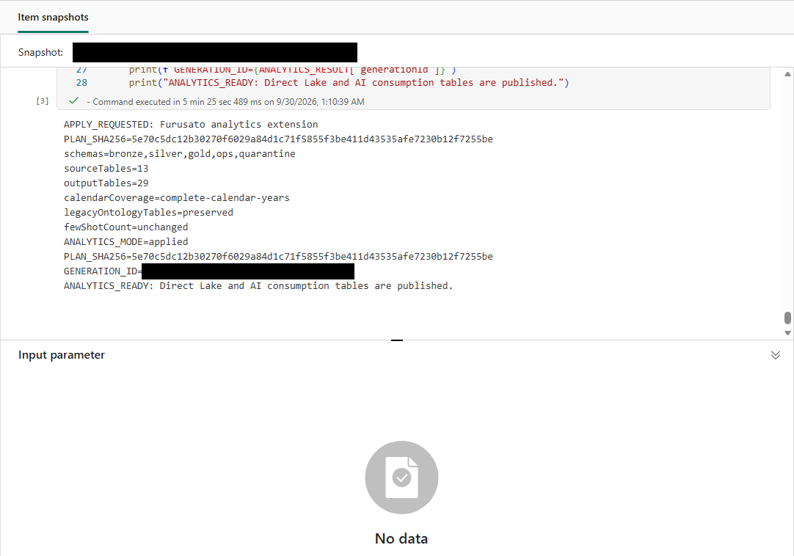

# 11.2 操作手順（1）

[Lab 目次](../README.md) · [この章の目次](README.md)

1. パラメーターセルで PARTICIPANT_ID を自分の &lt;PID&gt; にします。INCREMENT_PATH は "Files/increment"、APPLY_CHANGES は False のままにして、すべてのセルを実行します（プレビュー）。
2. 出力された PLAN_SHA256 の値と、入力・出力テーブルの計画を確認します。既存の ot_* テーブルは上書きされません。PLAN_SHA256 の値をそのままコピーします。
3. 同じ Lakehouse に書き込む他のセッションを閉じてから、APPLY_CHANGES = True、CONFIRMED_PLAN_SHA256 = コピーした値、EXCLUSIVE_APPLY_WINDOW_CONFIRMED = True に設定し、もう一度すべてのセルを実行します。
4. 出力に ANALYTICS_MODE=applied と「ANALYTICS_READY: Direct Lake and AI consumption tables are published.」が表示されることを確認します。出力テーブルは29です。

Notebook 05 の適用の実行後の出力。ANALYTICS_MODE=applied、outputTables=29、ANALYTICS_READY の行を確認する

English

## 11.2 Steps

1. In the parameter cell, set PARTICIPANT_ID to your &lt;PID&gt;. Leave INCREMENT_PATH as "Files/increment" and APPLY_CHANGES as False, then run all cells (preview).
2. Review the printed PLAN_SHA256 value and the planned input and output tables. Existing ot_* tables are not overwritten. Copy the PLAN_SHA256 value exactly.
3. Close any other sessions that write to the same Lakehouse, then set APPLY_CHANGES = True, CONFIRMED_PLAN_SHA256 = the copied value and EXCLUSIVE_APPLY_WINDOW_CONFIRMED = True, and run all cells again.
4. Confirm that the output shows ANALYTICS_MODE=applied and "ANALYTICS_READY: Direct Lake and AI consumption tables are published." There are 29 output tables.

Output after the Notebook 05 apply run: check ANALYTICS_MODE=applied, outputTables=29 and the ANALYTICS_READY line.

