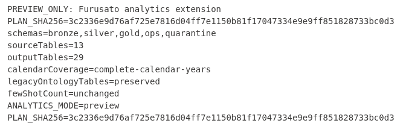

# 11.2 操作手順（1）

[Lab 目次](../README.md) · [この章の目次](README.md)

1. パラメーターセルで PARTICIPANT_ID を自分の &lt;PID&gt; にします。INCREMENT_PATH は "Files/increment"、APPLY_CHANGES は False のままにして、すべてのセルを実行します（プレビュー）。入力ファイルの内容と完全性を確認できない場合は適用へ進まず、未確認として記録します。
2. 出力された PLAN_SHA256 の値と、入力・出力テーブルの計画を確認します。既存の ot_* テーブルは上書きされません。PLAN_SHA256 の値をそのままコピーします。

Notebook 05 のプレビュー計画出力（表示行のみを切り抜き）。PREVIEW_ONLY、ANALYTICS_MODE=preview、入力13テーブル・出力予定29テーブルを確認します。これはプレビュー計画だけで、apply・Gold 更新・新しい3.1実行の証拠ではありません。図の PLAN_SHA256 は使わず、適用時は自分のプレビューで新たに表示された値を使います。プレビュー出力と適用後出力は別々の表示例で、同じ実行の一組ではありません。

English

## 11.2 Steps

1. In the parameter cell, set PARTICIPANT_ID to your &lt;PID&gt;. Leave INCREMENT_PATH as "Files/increment" and APPLY_CHANGES as False, then run all cells (preview). If input-file contents and completeness are not verified, do not proceed to apply; record them as unverified.
2. Review the printed PLAN_SHA256 value and the planned input and output tables. Existing ot_* tables are not overwritten. Copy the PLAN_SHA256 value exactly.

Notebook 05 preview-plan output, cropped to the displayed lines. It shows PREVIEW_ONLY, ANALYTICS_MODE=preview, 13 source tables and 29 planned output tables. This is preview-plan evidence only—not evidence of apply, Gold updates or a fresh 3.1 run. Do not reuse the illustrated PLAN_SHA256; use the value freshly printed by your own preview. The preview and applied-output images are separate examples, not a paired record from one run.

