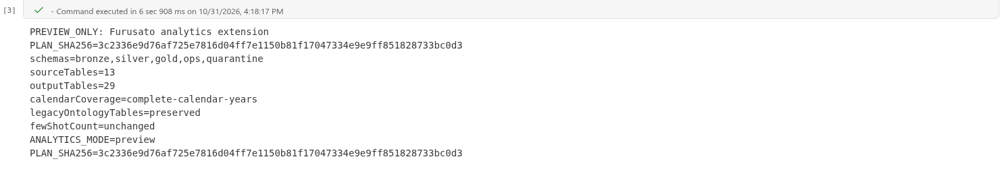

# 11.2 操作手順（1）

[Lab 目次](../README.md) · [この章の目次](README.md)

1. パラメーターセルで PARTICIPANT_ID を自分の &lt;PID&gt; にします。INCREMENT_PATH は "Files/increment"、APPLY_CHANGES は False のままにして、すべてのセルを実行します（プレビュー）。
2. 出力された PLAN_SHA256 の値と、入力・出力テーブルの計画を確認します。既存の ot_* テーブルは上書きされません。PLAN_SHA256 の値をそのままコピーします。

Notebook 05 のプレビュー実行。PREVIEW_ONLY・ANALYTICS_MODE=preview、入力13テーブル・出力予定29テーブルと PLAN_SHA256 を確認します。これは適用前の計画です。適用には、自分のプレビュー実行で表示されたハッシュを使います。

English

## 11.2 Steps

1. In the parameter cell, set PARTICIPANT_ID to your &lt;PID&gt;. Leave INCREMENT_PATH as "Files/increment" and APPLY_CHANGES as False, then run all cells (preview).
2. Review the printed PLAN_SHA256 value and the planned input and output tables. Existing ot_* tables are not overwritten. Copy the PLAN_SHA256 value exactly.

Notebook 05 preview run. Check PREVIEW_ONLY, ANALYTICS_MODE=preview, 13 source tables, 29 planned output tables and PLAN_SHA256. This is the plan before apply. Use the hash from your own preview execution for apply.

