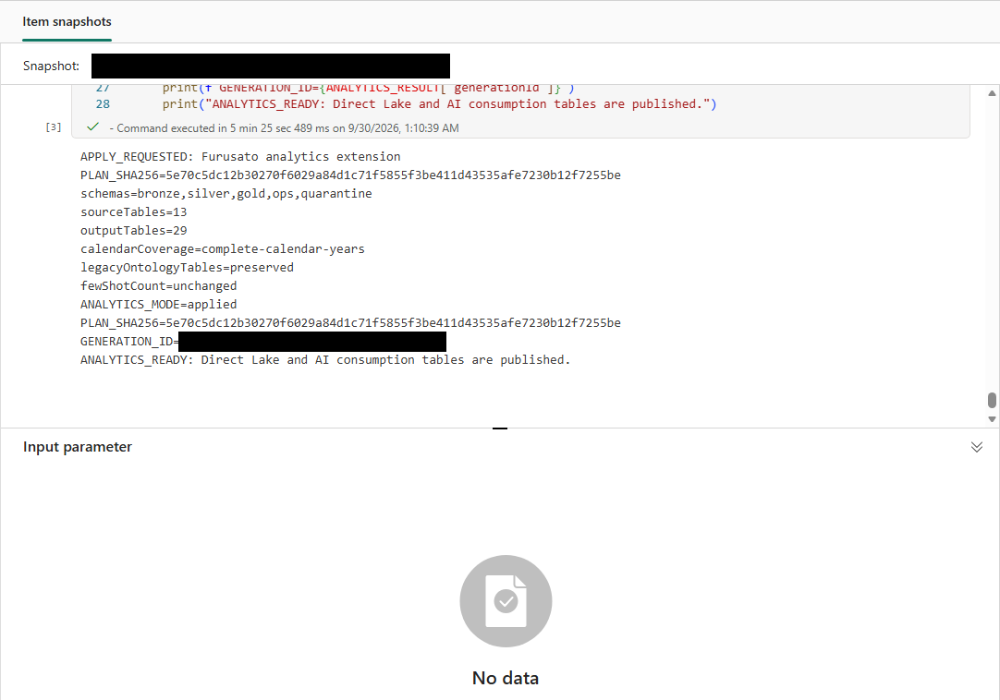
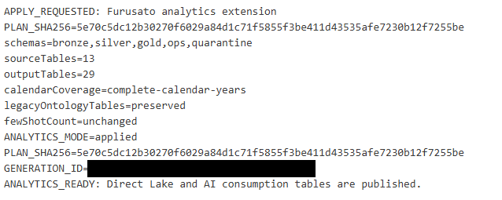

# 11.2 操作手順（2）

[Lab 目次](../README.md) · [この章の目次](README.md)

3. 同じ Lakehouse に書き込む他のセッションを閉じてから、APPLY_CHANGES = True、CONFIRMED_PLAN_SHA256 = コピーした値、EXCLUSIVE_APPLY_WINDOW_CONFIRMED = True に設定し、もう一度すべてのセルを実行します。
4. Notebook 05 の apply/job が成功し、出力に ANALYTICS_MODE=applied と「ANALYTICS_READY: Direct Lake and AI consumption tables are published.」が表示されることを確認します。Gold の件数・金額は次の手順で確認します。Lakehouse Explorer のプレビュー、SQL analytics endpoint の照会、Notebook の実行結果をそれぞれ別に確認します。

Notebook 05 の適用出力例。ANALYTICS_MODE=applied、outputTables=29、ANALYTICS_READY が表示されています。自分の実行では、最新のジョブと出力を確認します。

APPLY_REQUESTED から ANALYTICS_READY までの Notebook 05 出力例。generation は伏せられています。

English

## 11.2 Steps

3. Close any other sessions that write to the same Lakehouse, then set APPLY_CHANGES = True, CONFIRMED_PLAN_SHA256 = the copied value and EXCLUSIVE_APPLY_WINDOW_CONFIRMED = True, and run all cells again.
4. Confirm that the Notebook 05 apply/job succeeded and its output shows ANALYTICS_MODE=applied and "ANALYTICS_READY: Direct Lake and AI consumption tables are published." Check Gold counts and amounts in the following steps. Check the Lakehouse Explorer preview, SQL analytics endpoint query and Notebook run output separately.

Notebook 05 apply-output example showing ANALYTICS_MODE=applied, outputTables=29 and ANALYTICS_READY. For your run, check the latest job and its output.

Notebook 05 output example from APPLY_REQUESTED through ANALYTICS_READY; generation is redacted.

