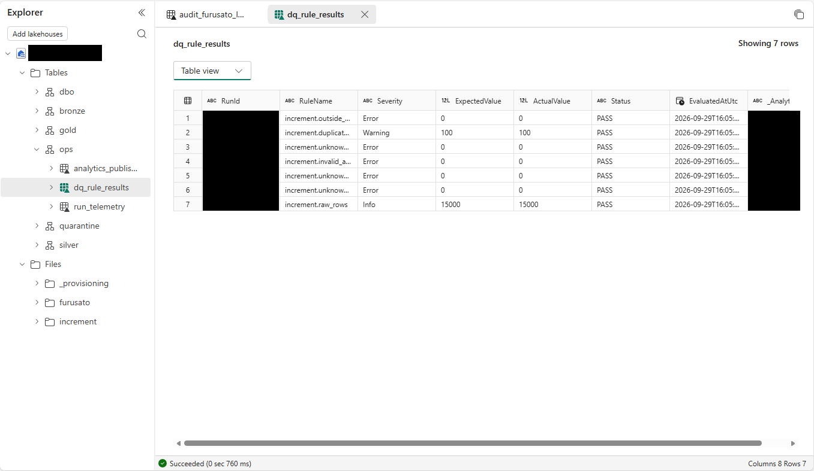

# 11.2 操作手順（3）

[Lab 目次](../README.md) · [この章の目次](README.md)

5. ops.dq_rule_results を開き、7つのルールがすべて PASS で、重複の期待値・実測値が 100、増分の行数の期待値・実測値が 15000 であることを確認します。

ops.dq_rule_results の品質チェックの結果。7つのルールすべてで期待値と実測値が一致し、Status は PASS（重複 100、増分の行数 15000）

English

## 11.2 Steps

5. Open ops.dq_rule_results and confirm that all seven rules are PASS, with an expected and actual duplicate count of 100 and an expected and actual increment row count of 15000.

Quality results in ops.dq_rule_results: all seven rules have matching expected and actual values and Status PASS (100 duplicates, 15000 increment rows).

