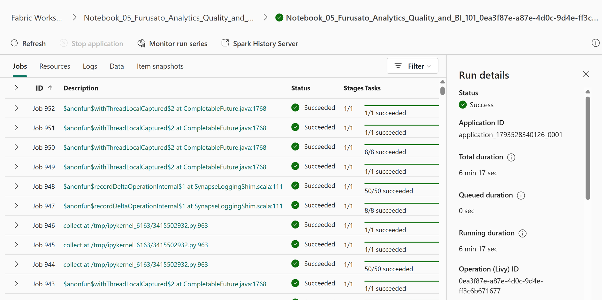

# 11.2 操作手順（3）

[Lab 目次](../README.md) · [この章の目次](README.md)

Notebook 05 の実際の Monitor 実行で Status=Success を確認します。これは Notebook の実行完了だけを示し、Gold の件数・金額・generation 整合性は OneLake の独立検証で確認します。

English

## 11.2 Steps

Notebook 05 Monitor shows an actual run with Status=Success. This proves only the notebook run completed; verify Gold counts, amounts and generation consistency independently through OneLake.

