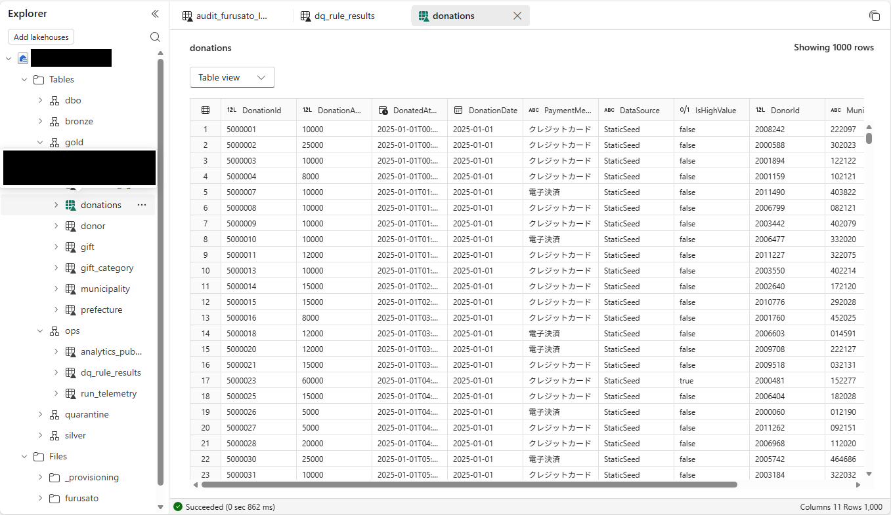

# 11.2 操作手順（3）

[Lab 目次](../README.md) · [この章の目次](README.md)

6. gold.donations を確認します。DataSource 列で StaticSeed（静的データ）と RealtimeIncrement（受け入れた増分）が区別されています。プレビューの「Showing 1000 rows」は一部の表示なので、件数は SQL で数えます。Gold 全体は 94,900件・1,596,157,000円（静的 80,000件・1,344,099,000円と、受け入れた増分 14,900件・252,058,000円）です。

gold.donations の列と先頭の行。DataSource で静的データと増分を区別し、IsHighValue は 57,000円を超える寄付で true

English

## 11.2 Steps

6. Check gold.donations. The DataSource column separates StaticSeed (static data) from RealtimeIncrement (accepted increments). The preview message "Showing 1000 rows" shows only part of the data, so count the rows with SQL. Gold has 94,900 rows / JPY 1,596,157,000 in total (static 80,000 / JPY 1,344,099,000 plus accepted increments 14,900 / JPY 252,058,000).

gold.donations columns and first rows: DataSource separates static data from increments, and IsHighValue is true for donations over JPY 57,000.

