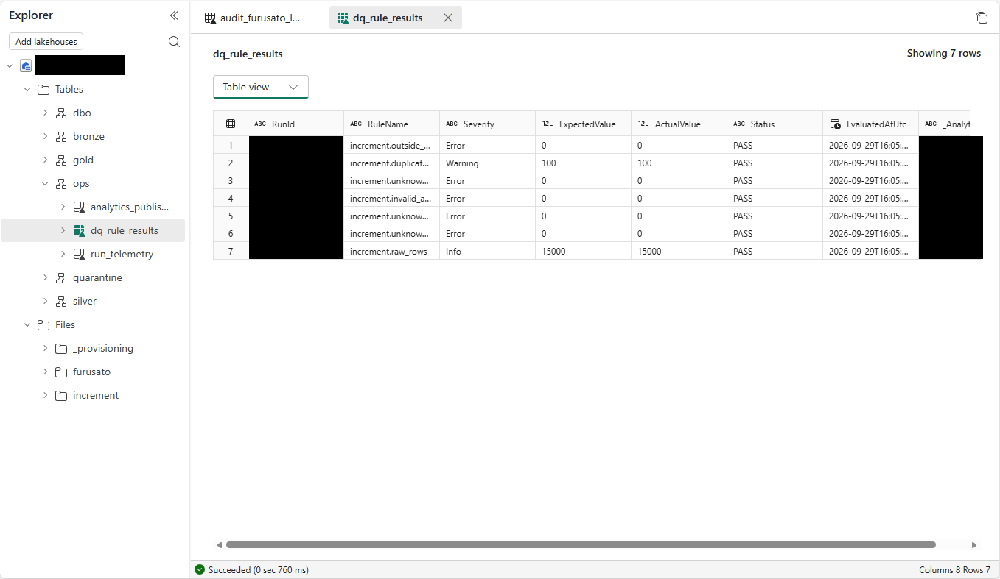
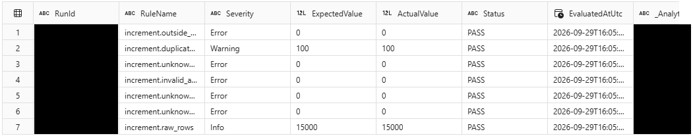
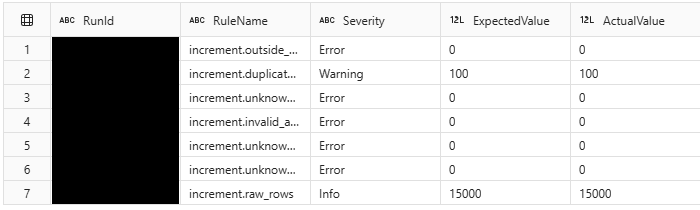
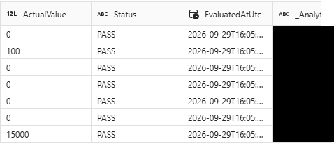

# 11.2 操作手順（4）

[Lab 目次](../README.md) · [この章の目次](README.md)

5. SQL/Gold の証拠境界を確認します。現在確認済みの読み取り専用 SQL catalog では静的 dbo.ot_donation は公開されていますが、ops.analytics_publish_control と gold.donations は公開されていません。したがって、この catalog から Gold の件数・金額や公開完了を SQL 結果として報告しません。利用可能な Notebook 出力や明示的に許可された検証手段が無ければ、Gold は未検証として記録します。
6. ops.dq_rule_results が現在の実行出力から実際に読める場合に限り、7ルールの状態、重複、増分行数を読み取って記録します。表示・照会できない場合は未確認とし、SQL catalog に公開されていると推定しません。

図は EvaluatedAtUtc=2026-09-29 の実行結果を示す参考例です（重複100件・増分15,000行などの表示値はこの実行時点のもの）。参加者は自分の Notebook 05 の最新実行ジョブと出力を確認し、7つすべての品質ルールの実際の判定を確認します。図の値を現在の結果として扱いません。

同じ保存済み表のヘッダーと7行すべての連続した切り抜きです。RunId と generation は伏せ字、RuleName と EvaluatedAtUtc は省略表示のままです。履歴の例であり、現在の Gold アクセス証拠ではありません。

同じ7行とヘッダーの左側拡大。行番号、RunId、RuleName、Severity、ExpectedValue、ActualValueを保持します。次の右側とActualValue列が重なり、行の順序と高さは同じです。伏せ字と省略表示は復元していません。

同じ7行とヘッダーの右側拡大。左側と重なるActualValue、Status、EvaluatedAtUtc、伏せ字の最終列を保持します。行順・高さとActualValueの重なりで左側に対応づけます。値は実行ごとに変わるため、自分の最新の結果を確認します。

English

## 11.2 Steps

5. Observe the SQL/Gold evidence boundary. The currently verified read-only SQL catalog exposes static dbo.ot_donation, but not ops.analytics_publish_control or gold.donations. Therefore, do not report Gold counts, amounts or publication completion as SQL results from this catalog. If Notebook output or an explicitly authorized verification method is unavailable, record Gold as unverified.
6. Only if ops.dq_rule_results is actually readable from the current run output, inspect and record the seven rule statuses, duplicate count and increment row count. If it cannot be displayed or queried, record it as unverified; do not infer that the SQL catalog exposes it.

This figure is an illustrative run dated EvaluatedAtUtc=2026-09-29; displayed values such as 100 duplicates and 15,000 increment rows belong to that run. Participants must check their own latest Notebook 05 job and output to verify the actual verdicts for all seven quality rules. Do not treat the figure’s values as current results.

Contiguous crop of the same retained table header and all seven rows. RunId and generation remain redacted; RuleName and EvaluatedAtUtc remain ellipsized. This is a historical illustration, not current Gold-access evidence.

Enlarged left panel of the same seven rows and header: row indexes, RunId, RuleName, Severity, ExpectedValue and ActualValue. ActualValue overlaps the next right panel; row order and heights are unchanged. Redactions and ellipses are not recovered.

Enlarged right panel of the same seven rows and header: the overlapping ActualValue column, Status, EvaluatedAtUtc and redacted final column. Match rows to the left panel using unchanged order/heights and the ActualValue overlap. Values can change between runs; check your own latest output.

