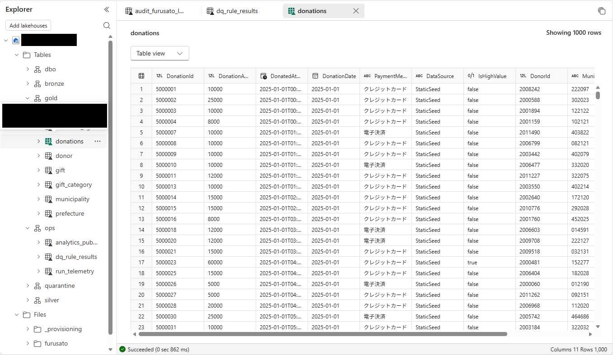

# 11.2 操作手順（5）

[Lab 目次](../README.md) · [この章の目次](README.md)

7. 対象 endpoint から `gold.donations` を実際に読める場合だけ、全テーブルを対象にした SQL 集計を実行し、集計条件と DataSource 別の件数・金額を記録して3つの入力 CSV の期待値と照合します。3つすべてを処理した場合の 94,900件・1,596,157,000円は期待値であり、Explorer のプレビューや Notebook の成功表示から得た実測値ではありません。対象のテーブルが読めない場合は未確認のままとし、権限を追加したり共有ワークスペースを変更したりしません。

Lakehouse Explorer で gold.donations のサンプル行を表示したプレビューです。最大1,000行が表示されても全件数・合計金額ではなく、SQL analytics endpoint の照会結果でもありません。

English

## 11.2 Steps

7. Only if `gold.donations` is actually readable from the target endpoint, run a SQL aggregation over the full table, record its scope and counts/amounts by DataSource, and compare them with the expected values for the three input CSVs. The 94,900 rows / JPY 1,596,157,000 expected after processing all three files are expectations, not measurements from the Explorer preview or a Notebook success indicator. If the target table is not readable, leave the result unverified; do not grant permissions or change the shared workspace.

Sample-row preview of gold.donations in Lakehouse Explorer. Even if up to 1,000 rows are displayed, this is not the full row count or total amount, and it is not a SQL analytics endpoint query result.

