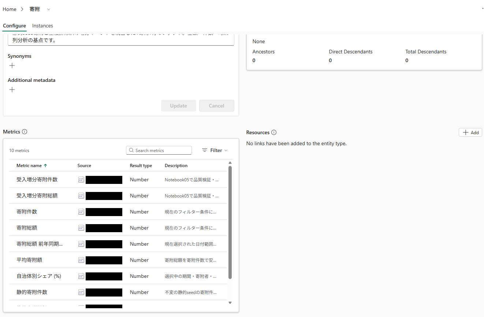

# 12.2 操作手順（1）

[Lab 目次](../README.md) · [この章の目次](README.md)

1. Semantic model の「寄附」テーブルで、寄附総額 = SUM('寄附'[寄附金額])、寄附件数 = COUNTROWS('寄附')、平均寄附額 = DIVIDE([寄附総額], [寄附件数]) の定義と表示形式を確認します。
2. 次の DAX を Semantic model に対して実行し、StaticSeed の範囲で 80,000件・1,344,099,000円になることを確認します。データソースの条件を付けない Gold 全体の値（94,900件）とは比べません。

**DAX**

```dax
EVALUATE
CALCULATETABLE(
    ROW("Donation count", [寄附件数],
        "Donation amount JPY", [寄附総額],
        "Average JPY", [平均寄附額]),
    '寄附'[データソース] = "StaticSeed"
)
```

3. レイヤー別の4つのメジャー（下の表）を、次の DAX で確認します。静的は 80,000件・1,344,099,000円、受け入れた増分は 14,900件・252,058,000円です。

**DAX**

```dax
EVALUATE
ROW(
    "Static count", [静的寄附件数],
    "Static amount JPY", [静的寄附総額],
    "Accepted increment count", [受入増分寄附件数],
    "Accepted increment amount JPY", [受入増分寄附総額]
)
```

4. メジャーの実際の定義で、内側の KEEPFILTERS を確認します。次の2つは既存のメジャーの定義です。通常の CALCULATE の同じ列へのフィルター置換と、KEEPFILTERS による既存条件との共通部分を区別し、矛盾した条件の BLANK を0件と読み替えません。

**DAX**

```dax
[静的寄附件数] = CALCULATE([寄附件数], KEEPFILTERS('寄附'[データソース] = "StaticSeed"))
[受入増分寄附件数] = CALCULATE([寄附件数], KEEPFILTERS('寄附'[データソース] = "RealtimeIncrement"))
```

5. 主 Ontology（ONT_Furusato_&lt;PID&gt;）の Metrics が設定済みかを確認します。設定されている場合だけ、各 Metric の Source、Applies to、View expression を Semantic model の定義と比べます。表示例は画面の読み方を示し、現在の配置の完了を証明するものではありません。



「寄附」の Configure 画面の Metrics 欄。Semantic model のメジャーが 10 metrics と表示される（図は一部）

<details>
<summary>English</summary>

## 12.2 Steps

1. In the 寄附 table of the semantic model, check the definitions and formats: 寄附総額 = SUM('寄附'[寄附金額]), 寄附件数 = COUNTROWS('寄附') and 平均寄附額 = DIVIDE([寄附総額], [寄附件数]).
2. Run the following DAX against the semantic model and confirm 80,000 donations and JPY 1,344,099,000 for StaticSeed. Do not compare the result with the Gold total without the data source filter (94,900).

**DAX**

```dax
EVALUATE
CALCULATETABLE(
    ROW("Donation count", [寄附件数],
        "Donation amount JPY", [寄附総額],
        "Average JPY", [平均寄附額]),
    '寄附'[データソース] = "StaticSeed"
)
```

3. Check the four layer-specific measures (table below) with the following DAX: static 80,000 / JPY 1,344,099,000 and accepted increments 14,900 / JPY 252,058,000.

**DAX**

```dax
EVALUATE
ROW(
    "Static count", [静的寄附件数],
    "Static amount JPY", [静的寄附総額],
    "Accepted increment count", [受入増分寄附件数],
    "Accepted increment amount JPY", [受入増分寄附総額]
)
```

4. Inspect the inner KEEPFILTERS in the actual measure definitions. The following are existing measures. Distinguish ordinary CALCULATE replacement of a filter on the same column from the intersection imposed by KEEPFILTERS, and do not interpret BLANK under conflicting filters as zero.

**DAX**

```dax
[静的寄附件数] = CALCULATE([寄附件数], KEEPFILTERS('寄附'[データソース] = "StaticSeed"))
[受入増分寄附件数] = CALCULATE([寄附件数], KEEPFILTERS('寄附'[データソース] = "RealtimeIncrement"))
```

5. Check whether Metrics are configured on the main ontology (ONT_Furusato_&lt;PID&gt;). Only when configured, compare each metric's Source, Applies to and View expression with the semantic model definitions. The illustrations explain the screen; they do not establish completion of the current deployment.


Metrics section of the 寄附 entity: the semantic model's measures are listed as 10 metrics (only part of the list is shown).

</details>
