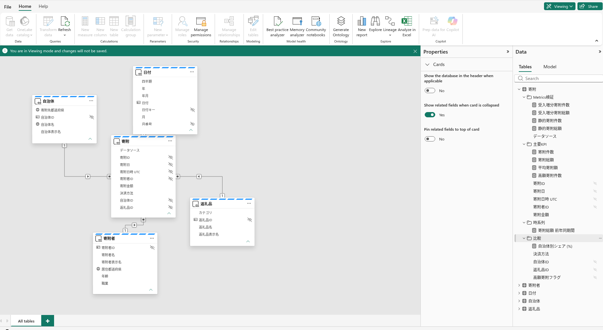

# 12.2 操作手順（1）

[Lab 目次](../README.md) · [この章の目次](README.md)

1. Semantic model の「寄附」テーブルで、寄附総額 = SUM('寄附'[寄附金額])、寄附件数 = COUNTROWS('寄附')、平均寄附額 = DIVIDE([寄附総額], [寄附件数]) の定義と表示形式を確認します。

Semantic model のモデルビュー（Viewing）。寄附・寄附者・日付・自治体・返礼品の5テーブルと関係の配置、右側の寄附にある10メジャー、非表示ではない寄附金額列を確認します。この画面は構成の確認です。メジャーの定義・実際の DAX 結果・Ontology の Metrics は、それぞれ別に確認します。

English

## 12.2 Steps

1. In the 寄附 table of the semantic model, check the definitions and formats: 寄附総額 = SUM('寄附'[寄附金額]), 寄附件数 = COUNTROWS('寄附') and 平均寄附額 = DIVIDE([寄附総額], [寄附件数]).

Semantic model view in Viewing mode. Inspect the five tables—寄附, 寄附者, 日付, 自治体 and 返礼品—their relationship layout, the ten measures under 寄附, and the visible 寄附金額 column. This screen verifies configuration. Check measure definitions, actual DAX results and ontology Metrics separately.

