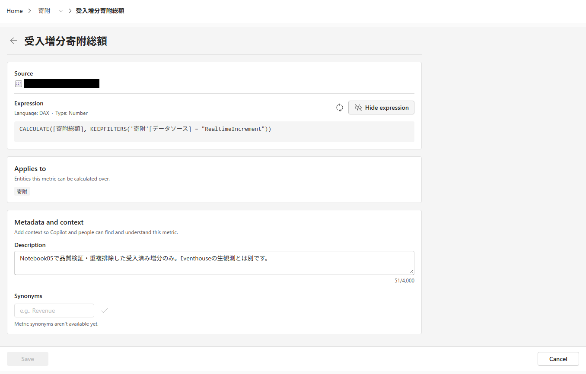

# 12.2 操作手順（2）

[Lab 目次](../README.md) · [この章の目次](README.md)

Metric の詳細（受入増分寄附総額）。View expression で表示した元の DAX と、Applies to の「寄附」を確認する

English

## 12.2 Steps

Metric details (受入増分寄附総額): the original DAX shown with View expression, and Applies to 寄附.

