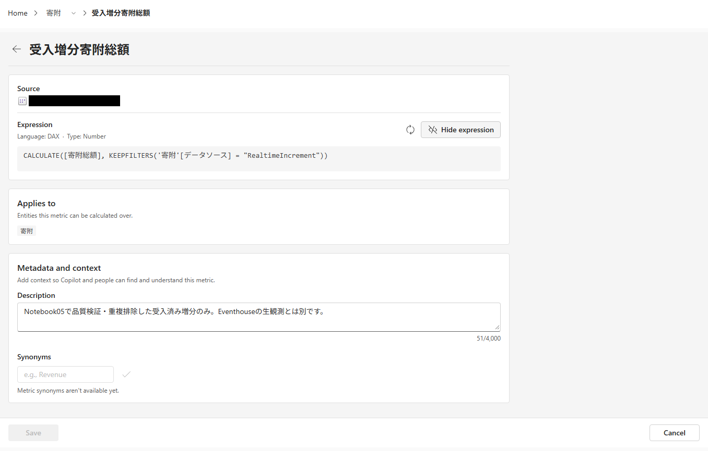
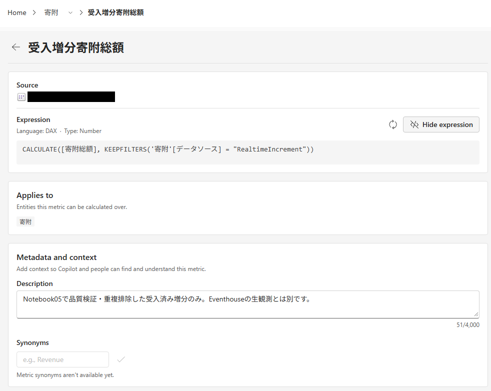

# 12.2 操作手順（3）

[Lab 目次](../README.md) · [この章の目次](README.md)

Metric の詳細（受入増分寄附総額）。View expression で表示した元の DAX と、Applies to の「寄附」を確認する

Metric の式、Applies to、説明が見える範囲です。Source は伏せ字、synonyms は未提供です。コピーして使う DAX の原文は本文にも掲載しています。

English

## 12.2 Steps

Metric details (受入増分寄附総額, accepted-increment donation total): the original DAX shown with View expression, and Applies to 寄附. Description: Only accepted increments quality-checked and deduplicated by Notebook 05; separate from Eventhouse observations.

This view shows the Metric expression, Applies to and description. Source is redacted and synonyms are unavailable. The copyable DAX source is also included in the instructions.

