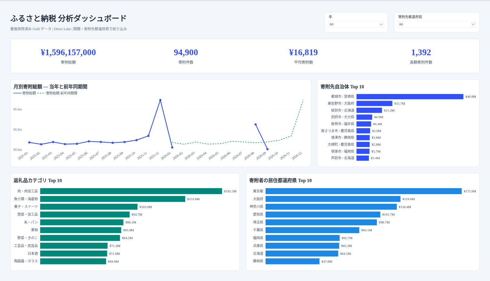

# 12.2 操作手順（4）

[Lab 目次](../README.md) · [この章の目次](README.md)

6. Metrics が未設定または利用できない場合は「未設定」または「実行できない」と記録し、講師に伝えます。Generate Ontology で2件目を作ったり、主 Ontology を置き換えたりしません。Semantic model の直接 DAX の確認は、そのまま別に記録します。
7. 任意：既存の SM_Furusato_Analytics_&lt;PID&gt; に接続した RPT_Furusato_Analytics_&lt;PID&gt; が配置済みの場合だけ開き、接続先が同じモデルであることを確認します（付録D）。レポートが無い場合はこの手順を省略し、新しいモデルや Ontology を作る必要はありません。年・寄附先都道府県を All にして、4つの KPI を同じ条件の直接 DAX と照合します。平均は表示の丸めを考慮します。グラフを検証するときは、対象・粒度・フィルターをそろえて値を個別に確認します。

任意の Power BI レポート。年・寄附先都道府県が All の表示で、Gold 全体の寄附総額1,596,157,000円・94,900件、平均16,819円（表示丸め）、高額寄付1,392件が表示されています。母集団は静的80,000件と受入増分14,900件です。Eventhouse の重複を含む観測15,000行や、静的データだけの値とは区別し、同じ条件の直接 DAX と照合します。

> Metric の Synonyms 欄に「Metric synonyms aren't available yet.」と表示されるのは、現在の仕様です。Metric には同義語を設定できないため、Entity の同義語の手順を使いません。

> Data Agent は、Ontology 経由では Semantic model の情報を使いません。17章で、Semantic model を Data Agent のソースとして直接追加します。

> 受け入れた増分のメジャーは Gold の RealtimeIncrement が対象で、Eventhouse の 15,000行を数えるものではありません。

English

## 12.2 Steps

6. If Metrics are unconfigured or unavailable, record that state and tell the instructor. Do not create a second ontology with Generate Ontology or replace the main ontology. Keep direct semantic-model DAX checks as a separate record.
7. Optional: open RPT_Furusato_Analytics_&lt;PID&gt; only if it is already deployed against the existing SM_Furusato_Analytics_&lt;PID&gt;, and verify that it uses that same model (Appendix D). Skip this step when no report is deployed; no new model or ontology is required. Set Year and recipient prefecture to All and compare the four KPIs with direct DAX under matching filters, allowing for display rounding of the average. Check chart values individually under the same scope, grain and filters when validating them.

Optional Power BI report with Year and recipient prefecture both set to All. The cards show all Gold: JPY 1,596,157,000, 94,900 donations, average JPY 16,819 after display rounding, and 1,392 high-value donations. This population combines 80,000 static donations with 14,900 accepted increments. Keep it distinct from the 15,000 duplicate-inclusive Eventhouse observations and static-only values, and compare with direct DAX under matching filters.

> The message "Metric synonyms aren't available yet." in a metric's Synonyms field reflects the current product behavior. Metrics cannot have synonyms, so do not apply the entity synonym steps to them.

> The Data Agent does not use semantic model information through the ontology. In Chapter 17 you add the semantic model directly as a Data Agent source.

> The accepted-increment measures cover RealtimeIncrement in Gold; they do not count the 15,000 Eventhouse rows.

