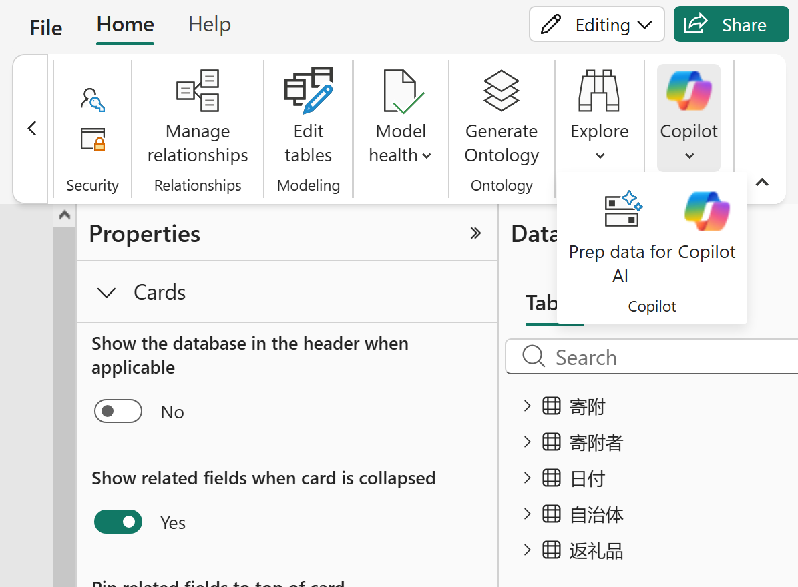

# 12.6 モデルを Prep for AI で準備する（1）

[Lab 目次](../README.md) · [この章の目次](README.md)

DAX 生成は Semantic model の metadata と Prep for AI を参照し、Agent 全体の Instructions に書いたモデル固有の計算・フィルター指示を参照しません。既存の日本語名、5テーブルの単方向スター型関係、10個の明示メジャーを使います。寄附金額は明示メジャーで集計し、数値キー・年齢・年・月番号は合計しません。追加の Agent、モデル、MCP、ライブラリの導入は不要です。

`workshop/v3.0.0-preview/powerbi/prep-for-ai/schema.json` は版管理された選択契約です。`model-instructions.txt` はモデル用の本文、`agent-instructions.txt` は共通の応答形式・ソース振り分け用の別候補です。ファイルの同梱、Notebook の配置、SDK の実行だけでは Prep for AI は有効になりません。この教材の自動配置はこれらを native 設定として適用せず、以下の許可された手動設定と確認が必要です。既存 Agent の frozen profile 適用手順と、この候補を混在させません。

AI instructions と AI data schema は LSDL に保存されます。公式の Copilot/ 定義スキーマと REST の定義例、Git・deployment pipeline 経由の編集に関する説明はありますが、この教材では定義経由の適用・読み戻しを検証していません。非対応と断定もせず、以下の native UI を確認済みの参加者経路とします。schema.json は公式 Copilot/ part そのものではありません。

1. 自分のモデルで変更が許可されていること、モデルの編集権限と組織の Copilot 利用条件を確認します。同じ Semantic model を Power BI service で開き、Viewing から Editing に切り替え、Home リボンの Copilot のドロップダウンから Prep data for AI を選びます。狭いリボンでは右の送りボタンで Copilot を表示します。Viewing mode の「changes will not be saved」表示中は編集・保存できず、そこで無効な項目があっても機能の不存在や Q&amp;A の無効を意味しません。編集できない場合は停止して担当者に確認します。モデルの Q&amp;A は前提条件なので有効状態を担当者と確認し、無効化する同意欄は選択しません。組織・テナント設定を勝手に変更せず、Q&amp;A 廃止後の代替設定も推測しません。
2. 開始画面の Simplify the data schema カードを選び、下表の業務列・メジャーに加え、依存列も確認・選択します。依存列には明示メジャー、関係、月の並べ替えに必要な非表示列を含みます。表示設定を一括変更したり、依存列を除いたりしません。寄附日時 UTC と日付キーだけを今回の優先スキーマから除外します。全5テーブルの41項目中39項目を、件数だけでなく名前で照合して Apply で保存します。狭いダイアログでは Back で開始画面のカードに戻ります。表示されていない横のタブを探す必要はありません。
3. 開始画面の Add AI instructions カードを選び、下の本文をそのまま貼り付け、Apply で保存します。モデル用本文は改行をLFに揃えると2,310文字で、上限10,000文字以内です。Close で閉じ、同じ経路から開き直してスキーマの項目名・選択状態と本文全文を照合します。本文が長いのでスクロールし、画面の先頭や文字数だけで一致と判断しません。Agent の Instructions や semantic-model source の非対応 Instructions/Description 欄には貼り付けません。画面が利用できなければ「native 設定未適用」と記録して停止します。
4. Data Agent の直接 Semantic model ソースで、同じ5テーブルと必要な列・メジャーの選択を照合します。現在の選択と異なる場合は差分をレビューし、許可なく拡張・上書きしません。AI schema は優先順位付けであって、認可境界でも全クエリの制限でもありません。RLS・OLS・権限は別途有効なまま維持します。

Editing モードの Home &gt; Copilot ドロップダウンから Prep data for AI を開きます。狭いリボンでは送りボタンで Copilot を表示します。実画面の上部を切り抜いた操作例です。

English

## 12.6 Prepare the model for AI

DAX generation uses semantic-model metadata and Prep for AI, not model-specific calculation/filter rules in Agent-wide Instructions. Use the existing Japanese names, five-table single-direction star schema and ten explicit measures. Aggregate donation amounts with explicit measures; do not sum numeric keys, age, year or month number. No additional agent, model, MCP server or library installation is needed.

`workshop/v3.0.0-preview/powerbi/prep-for-ai/schema.json` is the versioned selection contract. `model-instructions.txt` contains model-level guidance; `agent-instructions.txt` is a separate candidate for common response formatting and source routing. Shipping files, deploying notebooks or running the SDK does not activate Prep for AI. Automated deployment does not apply these as native settings; authorized manual setup and verification below are required. Do not mix this candidate with the existing Agent's frozen-profile apply procedure.

AI instructions and AI data schemas are saved to the LSDL. Official Copilot/ definition schemas, a REST definition example and guidance on edits through Git/deployment pipelines exist, but definition-based application/readback is unvalidated here, not declared unsupported. Use the native UI below as the proven participant route. schema.json is not itself an official Copilot/ definition part.

1. Confirm authorization to change your model, model authoring permission and organizational Copilot prerequisites. Open the same semantic model in the Power BI service, switch Viewing to Editing, then choose Home &gt; Copilot dropdown &gt; Prep data for AI. On a narrow ribbon, use the right paddle to bring Copilot into view. A Viewing mode banner saying changes will not be saved means edits cannot be saved; a disabled control there proves neither feature absence nor disabled Q&amp;A. Stop and consult the owner if editing is unavailable. Q&amp;A is a model prerequisite: confirm its enabled state with the owner and do not select a consent box that disables it. Do not change organization/tenant settings or guess a replacement after Q&amp;A retirement.
2. Choose the Simplify the data schema card on the landing screen. Review/select the business columns and measures below together with their dependency columns, including hidden fields needed by explicit measures, relationships and month sorting. Do not bulk-unhide fields or omit dependencies. Exclude only 寄附日時 UTC and 日付キー from this prioritized schema. Match all five tables' 39 selected fields out of 41 by name, not just count, then select Apply. In a narrow dialog, use Back to return to the landing cards; do not assume side-navigation tabs are visible.
3. Choose the Add AI instructions card, paste the exact model text below and select Apply. With LF line endings it contains 2,310 characters, below the 10,000-character limit. Select Close, reopen through the same route and compare the schema field names/selections and the entire instruction text. Scroll through the long text; its opening lines or character count alone do not prove equality. Do not paste it into Agent Instructions or unsupported semantic-model-source Instructions/Description fields. If the surface is unavailable, record native configuration as not applied and stop.
4. Reconcile the same five tables and required column/measure selections in the Agent's direct semantic-model source. Review differences from current selections; do not expand or overwrite them without authorization. The AI schema is prioritization, not an authorization boundary or a restriction on every query. Preserve RLS, OLS and permissions independently.

In Editing mode, open Home &gt; Copilot dropdown &gt; Prep data for AI. Use the ribbon paddle to bring Copilot into view on a narrow ribbon. This navigation example is a top crop of the actual UI.

