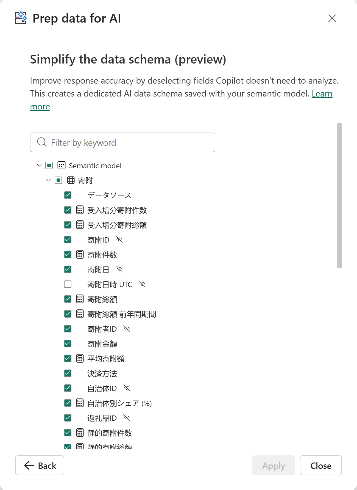

# 12.6 モデルを Prep for AI で準備する（2）

[Lab 目次](../README.md) · [この章の目次](README.md)

Simplify the data schema の寄附テーブルの保存後表示例。表示中の依存列も選択され、寄附日時 UTC は未選択です。下の項目はスクロールして照合します。Back は開始画面へ戻る操作、Apply が無効なのはこの表示に未保存の変更がない状態です。回答精度の証拠ではありません。

English

## 12.6 Prepare the model for AI

Saved donation-table example in Simplify the data schema. Visible dependency fields are selected and 寄附日時 UTC is unselected; scroll to compare the remaining fields. Back returns to the landing screen. Disabled Apply indicates no unsaved change in this view, not evidence of answer quality.

