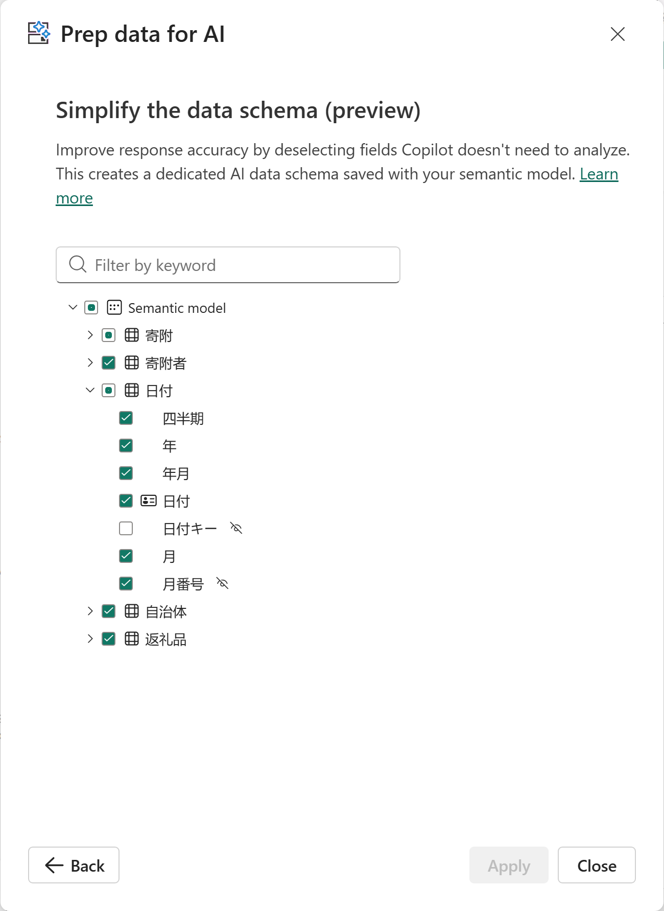

# 12.6 モデルを Prep for AI で準備する（3）

[Lab 目次](../README.md) · [この章の目次](README.md)

日付テーブルの保存後表示例。月番号を含む6項目が選択され、日付キーは未選択です。他テーブルも表の契約と項目名で照合します。件数やチェック記号だけでは全スキーマの一致を証明できません。

English

## 12.6 Prepare the model for AI

Saved date-table example: six fields including 月番号 are selected; 日付キー is unselected. Compare the other tables by field name against the contract too. Counts or checkmarks alone do not prove the entire schema matches.

