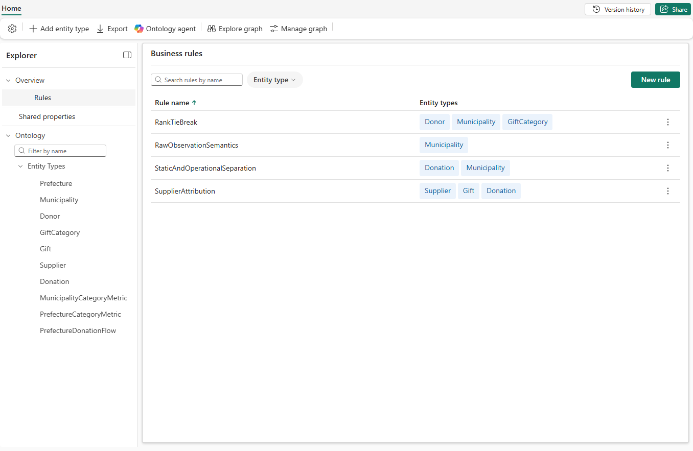

# 13.2 操作手順（1）

[Lab 目次](../README.md) · [この章の目次](README.md)

1. Entity type の Configure で、Entity metadata の Description、Synonyms、Additional metadata を入力し、Update を選びます。たとえば Prefecture の Synonyms に「都道府県」を追加します。同義語を設定できるのは Entity type だけです。
2. Property は Edit property metadata、Relationship は Metadata の Edit で説明（Description）を入力し、Update を選びます。単位（円）、粒度、データの層、「登録であり発送ではない」といった境界を書きます。
3. Explorer の Overview で Rules を開き、New rule（または Create rule）を選んで、Rule name と Rule definition を入力します。

Explorer の Overview → Rules で開く Business rules 画面。保存した Rule と、関連する Entity type が一覧表示される（図は4つの Rule がある状態）

English

## 13.2 Steps

1. In Configure for an entity type, enter Description, Synonyms and Additional metadata under Entity metadata, then select Update. For example, add 都道府県 to the Synonyms of Prefecture. Only entity types can have synonyms.
2. For properties use Edit property metadata, and for relationships use Edit under Metadata, to enter a Description, then select Update. Write units (JPY), grain, data layer and boundaries such as "registration, not shipment".
3. Open Rules under Overview in Explorer, select New rule (or Create rule), and enter the Rule name and Rule definition.

Business rules page (Overview → Rules in Explorer): saved rules are listed with their linked entity types (the figure shows four rules).

