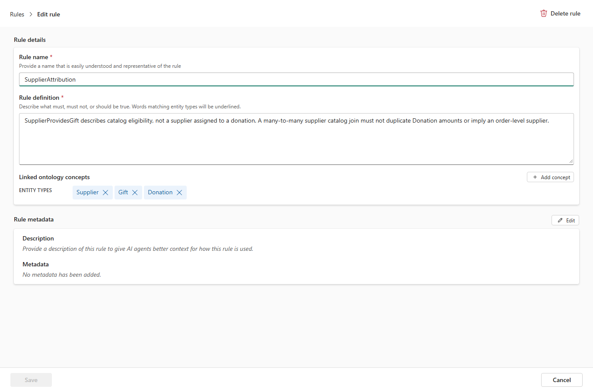

# 13.2 操作手順（2）

[Lab 目次](../README.md) · [この章の目次](README.md)

4. 例として、Rule name に SupplierAttribution、Rule definition に次の文を入力します。「SupplierProvidesGift はカタログへの登録を表し、寄付ごとに割り当てられた事業者ではない。多対多の結合で寄付金額を重複させたり、注文ごとの事業者を示したりしてはならない」という意味です。同じ名前の Rule がすでにある場合は、新しく作らずにその Rule を開いて確認します。

**Rule definition**

```text
SupplierProvidesGift describes catalog eligibility, not a supplier assigned to a donation. A many-to-many supplier catalog join must not duplicate Donation amounts or imply an order-level supplier.
```

5. Linked ontology concepts の Add concept で、Supplier、Gift、Donation を選びます。必要に応じて Rule metadata の Edit で Description を入力し（空のままでも保存できます）、Save を選びます。保存後に開き直し、文と関連付けが残っていることを確認します。



Rule の編集画面。Rule name・Rule definition と、Add concept でリンクした Supplier・Gift・Donation（Rule metadata は空）

<details>
<summary>English</summary>

## 13.2 Steps

4. As an example, enter SupplierAttribution as the Rule name and the following sentence as the Rule definition. It says that SupplierProvidesGift is a catalog registration, not a supplier assigned to each donation, and that the many-to-many join must not duplicate donation amounts or imply a supplier per order. If a rule with this name already exists, open and review it instead of creating a new one.

**Rule definition**

```text
SupplierProvidesGift describes catalog eligibility, not a supplier assigned to a donation. A many-to-many supplier catalog join must not duplicate Donation amounts or imply an order-level supplier.
```

5. Use Add concept under Linked ontology concepts to select Supplier, Gift and Donation. If needed, enter a Description with Edit under Rule metadata (you can also save with it empty), then select Save. Reopen the rule and check that the text and links were kept.


Edit rule page: Rule name, Rule definition, and Supplier, Gift and Donation linked with Add concept (Rule metadata is empty).

</details>
