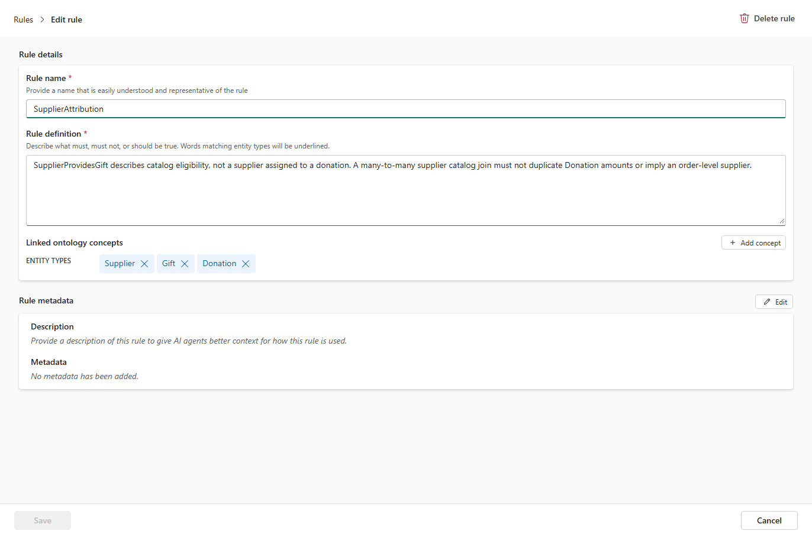

# 13.2 操作手順（2）

[Lab 目次](../README.md) · [この章の目次](README.md)

4. SupplierAttribution が見つからなかった場合は、Rule name に SupplierAttribution を入力し、Rule definition に次の文を使います。「SupplierProvidesGift はカタログへの登録を表し、寄付ごとに割り当てられた事業者ではない。多対多の結合で寄付金額を重複させたり、注文ごとの事業者を示したりしてはならない」という意味です。

**Readable wrapped view — Rule definition**

<div>
SupplierProvidesGift describes catalog eligibility, not a supplier assigned to a donation. A many-to-many supplier catalog join must not duplicate Donation amounts or imply an order-level supplier.
</div>

**Verbatim source follows; copy from the canonical block.**

**Rule definition**

```text
SupplierProvidesGift describes catalog eligibility, not a supplier assigned to a donation. A many-to-many supplier catalog join must not duplicate Donation amounts or imply an order-level supplier.
```

5. Linked ontology concepts を確認し、Supplier、Gift、Donation のうち不足しているものだけ Add concept で追加します。必要な変更がある場合だけ Save します。変更がなければ Save が無効のことがあります。Save を有効にするためだけに Rule や metadata を変更しないでください。保存後は開き直し、文と関連付けを確認します。



Rule の編集画面。Rule name・Rule definition と、Add concept でリンクした Supplier・Gift・Donation（Rule metadata は空）

<details>
<summary>English</summary>

## 13.2 Steps

4. If SupplierAttribution was not found, enter it as the Rule name and use the following sentence as the Rule definition. It says that SupplierProvidesGift is a catalog registration, not a supplier assigned to each donation, and that the many-to-many join must not duplicate donation amounts or imply a supplier per order.

**Readable wrapped view — Rule definition**

<div>
SupplierProvidesGift describes catalog eligibility, not a supplier assigned to a donation. A many-to-many supplier catalog join must not duplicate Donation amounts or imply an order-level supplier.
</div>

**Verbatim source follows; copy from the canonical block.**

**Rule definition**

```text
SupplierProvidesGift describes catalog eligibility, not a supplier assigned to a donation. A many-to-many supplier catalog join must not duplicate Donation amounts or imply an order-level supplier.
```

5. Check Linked ontology concepts and use Add concept only for any missing item among Supplier, Gift and Donation. Select Save only when you made an actual change. Save may be disabled when nothing changed; do not edit the rule or metadata just to enable it. Reopen the rule after saving and check its text and links.


Edit rule page: Rule name, Rule definition, and Supplier, Gift and Donation linked with Add concept (Rule metadata is empty).

</details>
