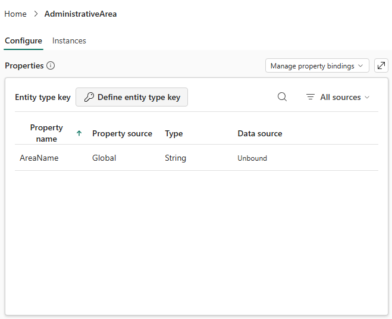

# 14.2 操作手順（1）

[Lab 目次](../README.md) · [この章の目次](README.md)

1. Namespace の操作が表示されるかを確認し、各概念の名前の範囲を読み取ります。Namespace の追加、名前変更、削除は行いません。
2. 共有プロパティの表示例で、Property source が Global、Data source が Unbound の意味を確認します。共有プロパティ自体にはデータのバインドがなく、Entity type ごとにバインドします。

親の AdministrativeArea。AreaName の Property source は Global（共有プロパティ）で、キーとバインドはまだ無い

English

## 14.2 Steps

1. Check whether namespace controls appear and inspect each concept's name scope. Do not add, rename or delete namespaces.
2. In the shared-property illustration, identify Property source Global and Data source Unbound. The shared property itself is not bound; binding belongs to each entity type.

Parent entity AdministrativeArea: AreaName has property source Global (a shared property); no entity key and no binding yet.

