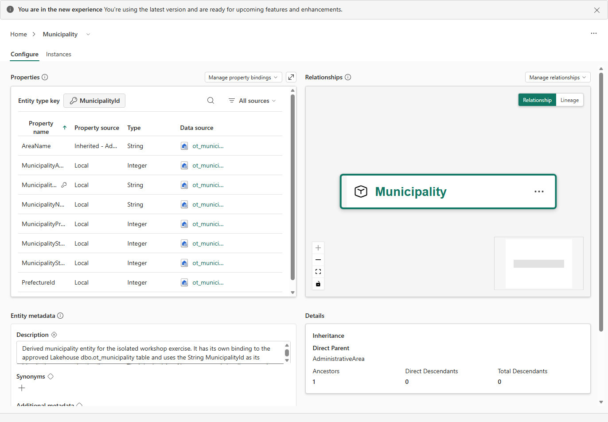

# 14.2 操作手順（2）

[Lab 目次](../README.md) · [この章の目次](README.md)

3. 継承の表示例で、Direct Parent と Inherited の意味を確認します。AdministrativeArea と Municipality は is-a の説明例です。現在の標準 Municipality に親を追加する操作は行いません。

継承で作った Municipality。AreaName は Inherited、Details の Direct Parent は AdministrativeArea

English

## 14.2 Steps

3. In the inheritance illustration, identify Direct Parent and Inherited. AdministrativeArea and Municipality illustrate is-a; do not add a parent to the standard Municipality.

Municipality created with inheritance: AreaName shows as Inherited, and Details list AdministrativeArea as the Direct Parent.

