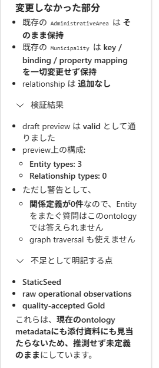

# 15.2 操作手順（1）

[Lab 目次](../README.md) · [この章の目次](README.md)

1. 主 Ontology のツールバーの Ontology agent を選びます。依頼を送る前に、入力欄の下で Plan を選択し、選択状態を確認します。参考図のボタンの色からモードを判断せず、Act・保存・提案の適用は行いません。
2. A：添付ファイルなしで、次の依頼を送ります。回答で、現在の Entity・キー・バインド・継承の確認結果、追加の案、変更しない部分、検証の結果（エラーと警告）を確認します。この章では Plan のまま確認します。

**Readable prompt — 日本語**

<div>
Plan モードのまま、読み取りと未適用の下書きプレビューだけを行ってください。まず、この Ontology の Entity 名、型、キー、データのバインド、共有プロパティの参照と継承が設定されているかを、実際の定義から確認してください。添付資料がある場合は `business-requirements.txt`、`data-dictionary.txt`、`domain-model.png`、`revision-requirements.txt` も読み、実際のモデルの事実と、資料に書かれた説明を分けてください。静的データ（StaticSeed）、8月の観測データ（重複を含む）、Notebook 05 で品質処理した Gold の意味やつながりが入力に示されていなければ、推測せずに不足として書いてください。そのうえで、キーとバインドを持たない Entity「DonationQualityScope」を1つと、String のプロパティ「DataLayer」を1つだけ追加する未適用の下書きを提案し、読み取り専用のプレビューで、変更する部分と変更しない部分を確認してください。既存の Entity とプロパティの ID、型、キー、バインド、共有プロパティの参照、継承は変更せず、保存・Act・Graph の実体化・元データの変更は行わないでください。不足やプレビューのエラーは、そのまま報告してください。
</div>

**Verbatim prompt follows.**

```text
Plan モードのまま、読み取りと未適用の下書きプレビューだけを行ってください。まず、この Ontology の Entity 名、型、キー、データのバインド、共有プロパティの参照と継承が設定されているかを、実際の定義から確認してください。添付資料がある場合は `business-requirements.txt`、`data-dictionary.txt`、`domain-model.png`、`revision-requirements.txt` も読み、実際のモデルの事実と、資料に書かれた説明を分けてください。静的データ（StaticSeed）、8月の観測データ（重複を含む）、Notebook 05 で品質処理した Gold の意味やつながりが入力に示されていなければ、推測せずに不足として書いてください。そのうえで、キーとバインドを持たない Entity「DonationQualityScope」を1つと、String のプロパティ「DataLayer」を1つだけ追加する未適用の下書きを提案し、読み取り専用のプレビューで、変更する部分と変更しない部分を確認してください。既存の Entity とプロパティの ID、型、キー、バインド、共有プロパティの参照、継承は変更せず、保存・Act・Graph の実体化・元データの変更は行わないでください。不足やプレビューのエラーは、そのまま報告してください。
```

3. 回答と実際の定義が一致する場合だけ、緑の Preview ontology ボタンで読み取り専用の未適用プレビューを開きます。提案の実際の定義を基準と比較し、追加が DonationQualityScope 1 Entity・DataLayer 1 String Property だけで、合計11 Entity・15 Relationship、既存の ID・型・関係の始点／終点と向き・キー・バインド・共有参照・継承がすべて不変であることを確認します。図の3 Entity・0 Relationship・AdministrativeArea は主 Ontology の期待結果ではなく、不一致の回答例です。AI が valid や Error 0 と述べても、定義と矛盾する回答は FAIL、提案の定義を取得できない場合は未確認として記録し、適用・保存せず未適用プレビューを閉じます。Aの回答の誤りだけでは、安全なBの比較を禁止しません。次の手順で実際の主 Ontology の不変と Plan・書き込みなしを再確認できなければ、演習全体を停止します。



不一致として扱う添付なし（A）の回答例。Entity types 3・Relationship types 0、既存 AdministrativeArea と表示され、この章の主 Ontology の10 Entity・15 Relationship と一致しません。合格例や期待結果ではなく、この回答なら検証を停止します。層の意味を推測しない説明だけで定義の正しさは証明されません。提案の画面・入力欄・モード切替は図の範囲外です。依頼前に自分の画面で Plan を選択・確認し、提案を適用しません。

<details>
<summary>English</summary>

## 15.2 Steps

1. Select Ontology agent on the main ontology toolbar. Before prompting, select Plan below the input box and verify its selected state. Do not infer mode from button colors in an illustration; do not use Act, save or apply proposals.
2. A: Without attachments, send the following request. In the answer, check the findings about the current entities, keys, bindings and inheritance, the proposed addition, the parts that stay unchanged and the validation results (errors and warnings). Keep Plan selected throughout this chapter.

**Readable prompt — English**

<div>
Stay in Plan mode and perform only reading and an unapplied draft preview. First, check from the actual definition the entity names, types, keys, data bindings, whether shared-property references or inheritance are configured. If files are attached, also read `business-requirements.txt`, `data-dictionary.txt`, `domain-model.png` and `revision-requirements.txt`, and keep facts about the actual model separate from explanations taken from the documents. If the meaning of, or the links between, the static data (StaticSeed), the August observation data (including duplicates) and the Gold data quality-processed by Notebook 05 are not given in the input, do not guess; list them as missing. Then propose an unapplied draft that adds only one entity "DonationQualityScope" without a key or binding and only one String property "DataLayer", and use the read-only preview to confirm what changes and what stays the same. Do not change the IDs, types, keys, bindings, shared-property references or inheritance of existing entities and properties, and do not save, use Act, materialize a graph or change source data. Report any gaps or preview errors as they are.
</div>

**Verbatim prompt follows.**

```text
Stay in Plan mode and perform only reading and an unapplied draft preview. First, check from the actual definition the entity names, types, keys, data bindings, whether shared-property references or inheritance are configured. If files are attached, also read `business-requirements.txt`, `data-dictionary.txt`, `domain-model.png` and `revision-requirements.txt`, and keep facts about the actual model separate from explanations taken from the documents. If the meaning of, or the links between, the static data (StaticSeed), the August observation data (including duplicates) and the Gold data quality-processed by Notebook 05 are not given in the input, do not guess; list them as missing. Then propose an unapplied draft that adds only one entity "DonationQualityScope" without a key or binding and only one String property "DataLayer", and use the read-only preview to confirm what changes and what stays the same. Do not change the IDs, types, keys, bindings, shared-property references or inheritance of existing entities and properties, and do not save, use Act, materialize a graph or change source data. Report any gaps or preview errors as they are.
```

3. Only if the answer agrees with actual definitions, open the green Preview ontology button as a read-only, unapplied preview. Compare its actual definition with the baseline: add only one DonationQualityScope entity and one String DataLayer property, yielding eleven entities and fifteen relationships, with every existing ID, type, relationship endpoint/direction, key, binding, shared reference and inheritance unchanged. The figure's three entities, zero relationships and AdministrativeArea are a mismatched answer example, not the expected main-ontology result. Even if AI says valid or Error 0, record contradictory assertions as FAIL and an unavailable proposed definition as unverified; do not apply or save, and close the unapplied preview. An incorrect A answer alone does not prohibit safe comparison B. Stop the whole exercise if the next step cannot confirm the actual main ontology is unchanged and Plan/no-write safety is maintained.


Rejected/mismatched response example without attachments (A): Entity types 3, Relationship types 0 and existing AdministrativeArea do not match this chapter’s ten-entity, fifteen-relationship main ontology. This is not an expected or passing result; stop validation on such an answer. Saying that the available evidence does not establish what the data layer means does not establish definition fidelity. Visible Japanese answer (translated summary; illustrative, not an accepted result): StaticSeed, duplicate-inclusive Eventhouse observations and quality-accepted Gold are not established by the visible ontology metadata, so their meaning remains undefined; the proposed preview adds only one keyless, unbound DonationQualityScope entity with a String DataLayer property, while leaving existing entities and bindings unchanged. The draft preview displays three entities and no relationships with a structural warning; the answer says cross-entity questions may not work. The proposal canvas, input box and mode toggle are outside the crop. Do not infer the mode from this image; select and verify Plan in your own UI before prompting, and do not apply proposals.

</details>
