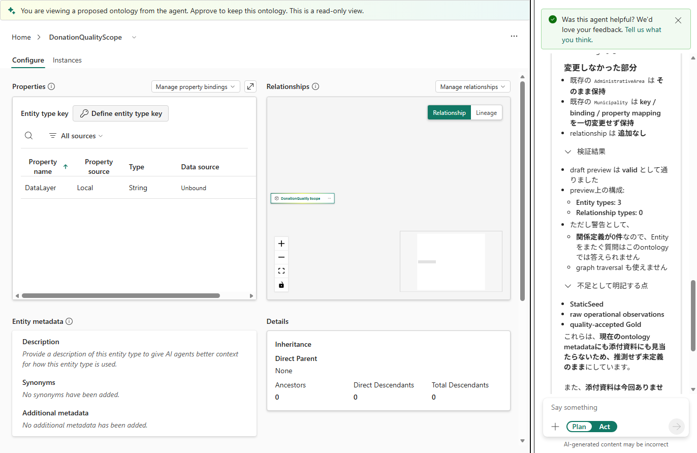

# 15.2 操作手順（1）

[Lab 目次](../README.md) · [この章の目次](README.md)

1. ツールバーの Ontology agent を選びます（空の Ontology では Start with Ontology agent）。入力欄の下で Plan が選ばれていることを確認します。
2. A：添付ファイルなしで、次の依頼を送ります。回答で、現在の Entity・キー・バインド・継承の確認結果、追加の案、変更しない部分、検証の結果（エラーと警告）を確認します。この章では Plan のまま確認します。

**Readable prompt — 日本語**

<div>
Plan モードのまま、読み取りと未適用の下書きプレビューだけを行ってください。まず、この Ontology の Entity 名、型、キー、データのバインド、共有プロパティの参照と継承が設定されているかを、実際の定義から確認してください。添付資料がある場合は business-requirements.pdf、data-dictionary.txt、domain-model.png、revision-requirements.txt も読み、実際のモデルの事実と、資料に書かれた説明を分けてください。静的データ（StaticSeed）、8月の観測データ（重複を含む）、Notebook 05 で品質処理した Gold の意味やつながりが入力に示されていなければ、推測せずに不足として書いてください。そのうえで、キーとバインドを持たない Entity「DonationQualityScope」を1つと、String のプロパティ「DataLayer」を1つだけ追加する未適用の下書きを提案し、読み取り専用のプレビューで、変更する部分と変更しない部分を確認してください。既存の Entity とプロパティの ID、型、キー、バインド、共有プロパティの参照、継承は変更せず、保存・Act・Graph の実体化・元データの変更は行わないでください。不足やプレビューのエラーは、そのまま報告してください。
</div>

**Verbatim prompt follows.**

```text
Plan モードのまま、読み取りと未適用の下書きプレビューだけを行ってください。まず、この Ontology の Entity 名、型、キー、データのバインド、共有プロパティの参照と継承が設定されているかを、実際の定義から確認してください。添付資料がある場合は business-requirements.pdf、data-dictionary.txt、domain-model.png、revision-requirements.txt も読み、実際のモデルの事実と、資料に書かれた説明を分けてください。静的データ（StaticSeed）、8月の観測データ（重複を含む）、Notebook 05 で品質処理した Gold の意味やつながりが入力に示されていなければ、推測せずに不足として書いてください。そのうえで、キーとバインドを持たない Entity「DonationQualityScope」を1つと、String のプロパティ「DataLayer」を1つだけ追加する未適用の下書きを提案し、読み取り専用のプレビューで、変更する部分と変更しない部分を確認してください。既存の Entity とプロパティの ID、型、キー、バインド、共有プロパティの参照、継承は変更せず、保存・Act・Graph の実体化・元データの変更は行わないでください。不足やプレビューのエラーは、そのまま報告してください。
```

3. 回答の緑の Preview ontology ボタンでプレビューを開きます。画面の上部に「You are viewing a proposed ontology from the agent. … This is a read-only view.」と表示され、追加される Entity と、変更しない部分を確認できます。プレビューは読み取り専用で、まだ保存されていません。



添付なし（A）の提案。DataLayer（String）は追加されるが説明は空で、資料に無い層の意味は推測していない

<details>
<summary>English</summary>

## 15.2 Steps

1. Select Ontology agent on the toolbar (Start with Ontology agent on an empty ontology). Confirm that Plan is selected below the input box.
2. A: Without attachments, send the following request. In the answer, check the findings about the current entities, keys, bindings and inheritance, the proposed addition, the parts that stay unchanged and the validation results (errors and warnings). Keep Plan selected throughout this chapter.

**Readable prompt — English**

<div>
Stay in Plan mode and perform only reading and an unapplied draft preview. First, check from the actual definition the entity names, types, keys, data bindings, whether shared-property references or inheritance are configured. If files are attached, also read business-requirements.pdf, data-dictionary.txt, domain-model.png and revision-requirements.txt, and keep facts about the actual model separate from explanations taken from the documents. If the meaning of, or the links between, the static data (StaticSeed), the August observation data (including duplicates) and the Gold data quality-processed by Notebook 05 are not given in the input, do not guess; list them as missing. Then propose an unapplied draft that adds only one entity "DonationQualityScope" without a key or binding and only one String property "DataLayer", and use the read-only preview to confirm what changes and what stays the same. Do not change the IDs, types, keys, bindings, shared-property references or inheritance of existing entities and properties, and do not save, use Act, materialize a graph or change source data. Report any gaps or preview errors as they are.
</div>

**Verbatim prompt follows.**

```text
Stay in Plan mode and perform only reading and an unapplied draft preview. First, check from the actual definition the entity names, types, keys, data bindings, whether shared-property references or inheritance are configured. If files are attached, also read business-requirements.pdf, data-dictionary.txt, domain-model.png and revision-requirements.txt, and keep facts about the actual model separate from explanations taken from the documents. If the meaning of, or the links between, the static data (StaticSeed), the August observation data (including duplicates) and the Gold data quality-processed by Notebook 05 are not given in the input, do not guess; list them as missing. Then propose an unapplied draft that adds only one entity "DonationQualityScope" without a key or binding and only one String property "DataLayer", and use the read-only preview to confirm what changes and what stays the same. Do not change the IDs, types, keys, bindings, shared-property references or inheritance of existing entities and properties, and do not save, use Act, materialize a graph or change source data. Report any gaps or preview errors as they are.
```

3. Open the preview with the green Preview ontology button in the answer. The top of the screen shows "You are viewing a proposed ontology from the agent. … This is a read-only view.", and you can review the entity to be added and the unchanged parts. The preview is read-only, and nothing is saved yet.


Proposal without attachments (A): DataLayer (String) is added, its description stays empty, and undefined layers are not guessed.

</details>
