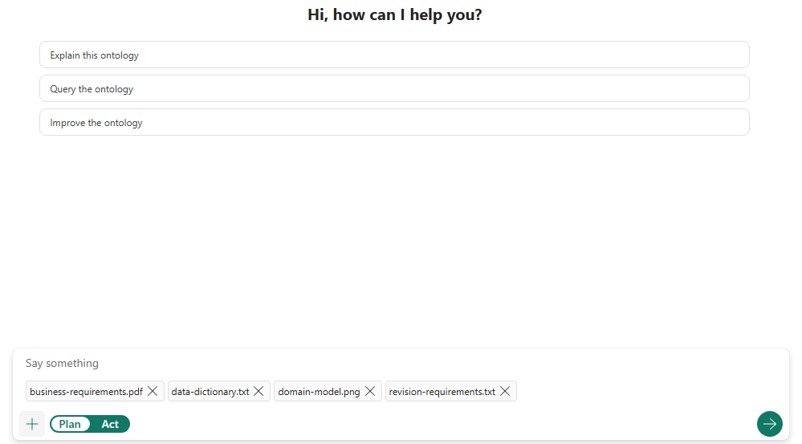

# 15.2 操作手順（2）

[Lab 目次](../README.md) · [この章の目次](README.md)

4. B：ページを更新して新しい会話を始めます（更新すると前の会話は終了します）。入力欄の添付ボタンから4つのファイルを添付し、A と同じ依頼をそのまま送ります。

新しい会話で4つのファイルを添付した状態。Plan のままプロンプトを入力して送信する

English

## 15.2 Steps

4. B: Refresh the page to start a new conversation (refreshing ends the previous one). Attach the four files with the attachment button in the input box and send exactly the same request as in A.

In a new conversation, attach the four files, keep Plan selected, then enter the prompt and send.

