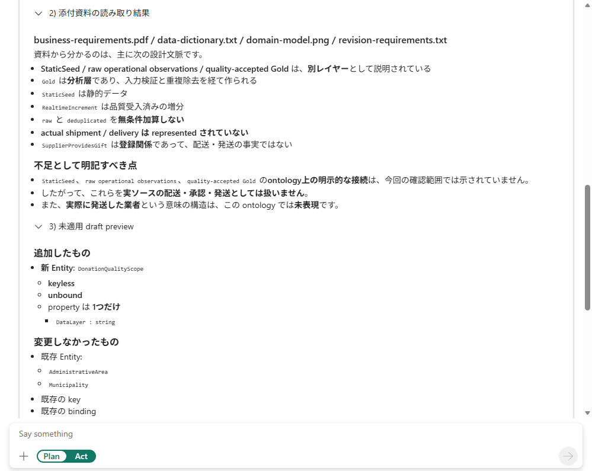

# 15.2 操作手順（3）

[Lab 目次](../README.md) · [この章の目次](README.md)

5. B の回答で、ファイル名が示され、資料から分かること（StaticSeed、品質処理した Gold、登録と発送の区別など）と、実際の Ontology の事実とが分けて書かれているかを確認します。回答の最後で、検証の結果（エラーと警告）と Preview ontology ボタンも確認します。

添付あり（B）の回答例。4つの資料からデータの層の違いを読み取り、配送や発送を推測していない

English

## 15.2 Steps

5. In B's answer, check that the file names are shown and that what the documents say (StaticSeed, quality-processed Gold, registration versus shipment and so on) is written separately from the facts of the actual ontology. At the end of the answer, also check the validation results (errors and warnings) and the Preview ontology button.

Answer with attachments (B): it uses all four files to keep the data layers apart and does not assume delivery or shipment.

