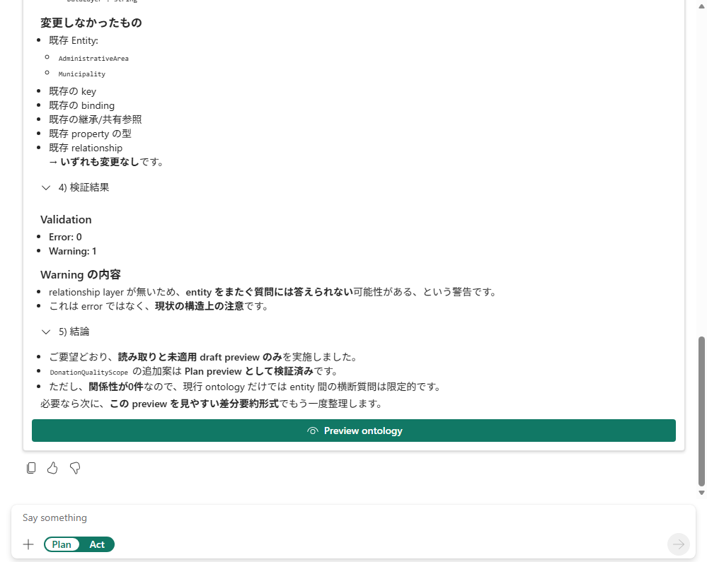

# 15.2 操作手順（3）

[Lab 目次](../README.md) · [この章の目次](README.md)

不一致を見つける回答例の末尾。Error 0・Warning 1 と表示されていますが、関係性が0件とも述べています。15 Relationship の主 Ontology に対する合格結果ではありません。AI の検証表示だけを信用せず、実際の定義と照合して停止します。Preview ontology ボタンがあっても適用しません。

English

## 15.2 Steps

End of a mismatched answer example: it reports 0 errors, 1 warning, but also zero relationships. The Japanese warning says that without a relationship layer, cross-entity questions may not be answerable; it calls this a structural caution, not an error. The conclusion says only reading and an unapplied Plan draft preview were performed and offers a more readable diff summary. This is not a passing result for the main ontology with fifteen relationships. Check actual definitions rather than accepting AI validation claims, and stop on the mismatch; the Preview ontology button does not authorize applying it.

