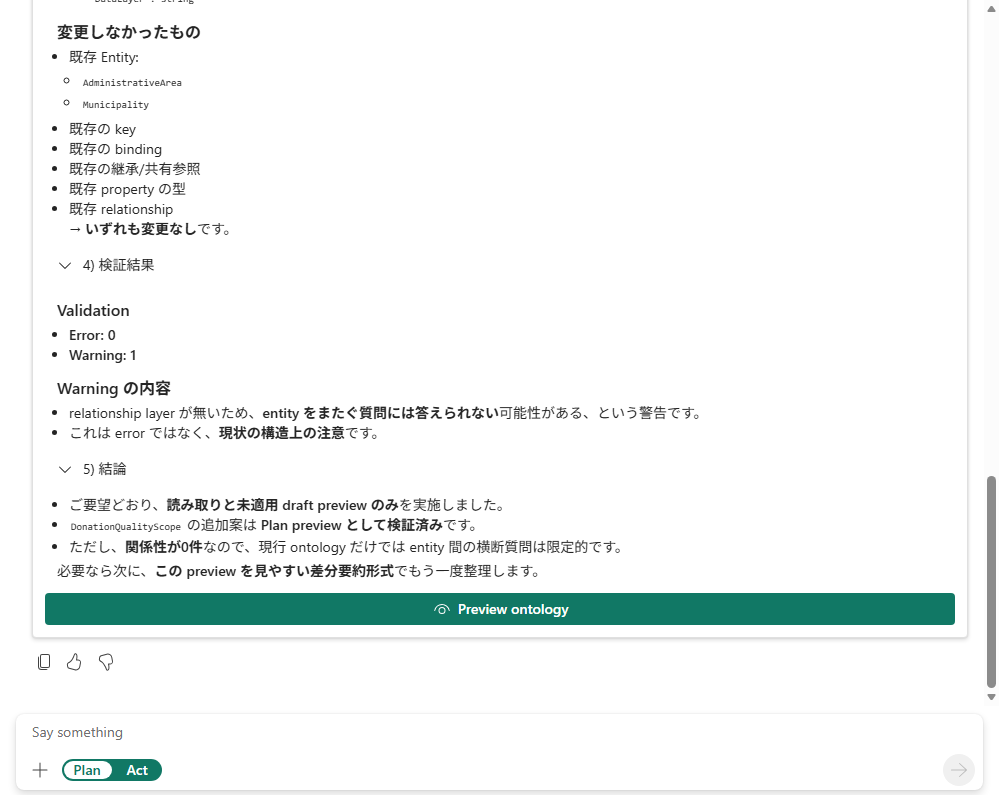

# 15.2 操作手順（4）

[Lab 目次](../README.md) · [この章の目次](README.md)

回答の末尾。検証の結果（エラー0件・警告1件）を確認し、緑の Preview ontology ボタンで提案を開く

English

## 15.2 Steps

End of the answer: check the validation results (0 errors, 1 warning), then open the proposal with the green Preview ontology button.

