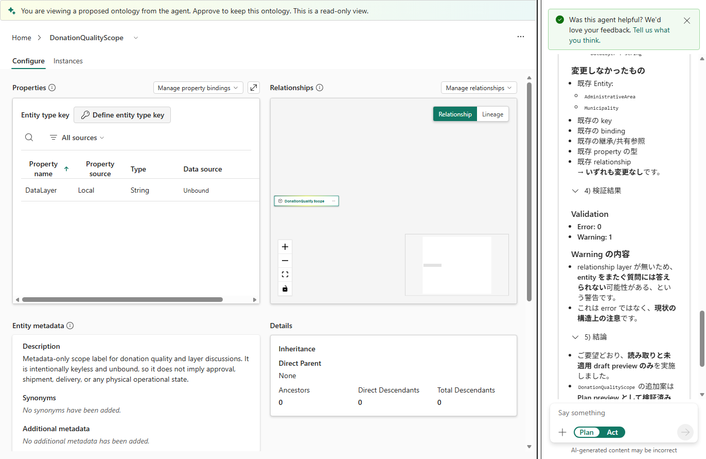

# 15.2 操作手順（4）

[Lab 目次](../README.md) · [この章の目次](README.md)

6. Bの実際の提案定義を同じ基準で照合し、Aの成否とは独立して合否・未確認を記録します。添付ファイルで説明が変わっても、合計11 Entity・15 Relationship と既存の ID・型・関係の始点／終点と向き・キー・バインド・共有参照・継承の保持を確認します。関係が無いという添付図の回答も主 Ontology には不一致で、合格例ではありません。不一致は FAIL、提案定義取得不能は未確認とし、適用・保存せずプレビューを閉じます。実際の主 Ontology の基準や安全が不明・変更済みなら演習全体を停止します。比較は、居住／受入／登録、重複を含む値と含まない値、型・キー・向き・バインド、発送や資産の推測の有無、検証結果の5点で記録します。

添付あり（B）の提案の参考例。DataLayer の説明は承認や配送を意味しないとしていますが、右の回答は関係の層が無いと述べています。15 Relationship を保持する主 Ontology の合格例ではありません。Error 0・Warning 1 の表示にかかわらず、実際の定義が一致しなければ停止し、適用しません。

English

## 15.2 Steps

6. Compare B's actual proposed definition against the same baseline and record its pass/fail/unverified outcome independently of A's outcome. Explanations may change with attachments, but verify eleven entities, fifteen relationships and preservation of existing IDs, types, relationship endpoints/directions, keys, bindings, shared references and inheritance. The attached response claiming no relationships is also mismatched to the main ontology, not a passing example. Record mismatch as FAIL or unavailable proposed definitions as unverified; close the preview without applying or saving. Stop the whole exercise if the actual main baseline or safety is unknown or changed. Record five comparison points: residence/recipient/registration, values with/without duplicates, types/keys/directions/bindings, no guessing about shipment/assets, and validation results.

Proposal with attachments (B): DataLayer is Local, String and Unbound. Its file-grounded description says this data layer does not imply approval or delivery; the screen shows Error 0 and Warning 1. The visible Japanese response says the missing relationship layer may limit cross-entity questions and that only reading plus an unapplied draft preview was performed. However, the response says no relationship layer is present: this is not a passing example for the main ontology retaining fifteen relationships. Stop if actual definitions do not reconcile, regardless of the AI validation labels, and do not apply.

