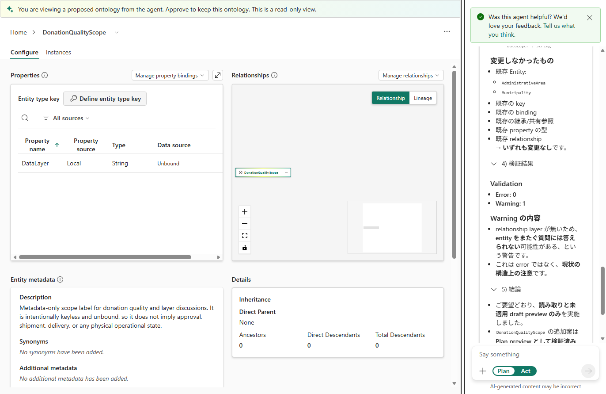

# 15.2 操作手順（5）

[Lab 目次](../README.md) · [この章の目次](README.md)

6. B のプレビューを開き、A と比べます。添付ファイルによって説明は変わっても、既存の ID・キー・バインド・継承は変わらず、追加は DonationQualityScope と DataLayer だけであることを確認します。比べた結果を、居住／受入／登録の区別、重複を含む値と含まない値の区別、型・キー・向き・バインド、発送や資産を推測していないか、検証の結果、の5点で記録します。

添付あり（B）の提案。DataLayer に加え、承認や配送を意味しないという説明が、資料をもとに入っている

English

## 15.2 Steps

6. Open B's preview and compare it with A. The explanations may change with the attachments, but existing IDs, keys, bindings and inheritance must stay the same, and the only additions must be DonationQualityScope and DataLayer. Record the comparison on five points: residence, recipient and registration; values with and without duplicates; types, keys, directions and bindings; no guessing about shipment or assets; and the validation results.

Proposal with attachments (B): besides DataLayer, it has a description, based on the files, saying that it implies no approval or delivery.

